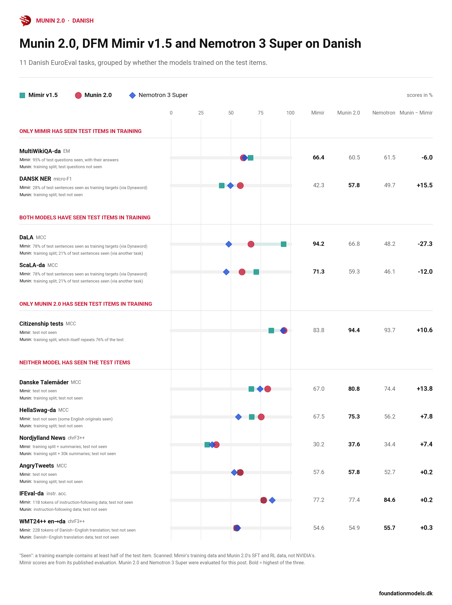

# Munin 2.0-udgivelsesnote

I dag udgiver vi Munin 2.0, den stærkeste fuldt åbne sprogmodel, der nogensinde er lavet i Danmark. Det er en 120B-model (12B aktive) til dansk og engelsk, bygget til agentisk softwareudvikling, og dens vægte kan frit bruges, også kommercielt. Vi har post-trænet den fra NVIDIA's prætrænede [Nemotron 3 Super Base](https://huggingface.co/nvidia/NVIDIA-Nemotron-3-Super-120B-A12B-Base-BF16) på under fem dages endelig træning: 2,5 dages supervised fine-tuning (SFT) på 128 GPU'er på LUMI og 2 dages reinforcement learning (RL) på 128 GPU'er på Gefion. Det er under 0,1 % af den regnekraft, der gik til basismodellen.

<!-- more -->

Munin 2.0 er vores første model trænet med RL. Munin 1.0 brugte kun SFT. I RL lærer modellen ved at forsøge sig med tusindvis af rigtige opgaver, hver i sit eget isolerede computermiljø. At køre de miljøer i stor skala er en stor del af arbejdet, og vi har bygget vores egen infrastruktur til det. Når vi gør det selv, bliver knowhowen i Danmark for en teknologi, der hurtigt er ved at blive kritisk infrastruktur. Vi offentliggør hele RL-opsætningen, og opsummeringer af træningsdata følger senere.

RL løftede SWE-bench Verified fra 58 % til 66 % og Terminal-Bench Lite fra 48 % til 64 %, på niveau med de 66,4 % på SWE-bench Verified, som NVIDIA rapporterer for den lige så store Qwen3.5-122B-A10B. RL-træningen indeholdt intet dansk og kun lidt matematik, men dansk, matematik og naturvidenskab blev også bedre, til niveau med NVIDIA's egen post-trænede Nemotron 3 Super, på benchmarks, der er rene for vores træningsdata. Uden nogen dedikeret sikkerhedstræning er Munin 2.0 nummer tre af 16 modeller til at undgå skadelige handlinger som agent, kun overgået af to lukkede frontier-modeller. Vi har også lavet en blind sammenligning af dansk kreativ skrivning på tværs af 13 modeller. Munin 2.0 blev nummer tre, og kun en model, der er mere end tre gange så stor, var klart bedre.

Herfra kan vi skalere på flere måder: mere regnekraft, flere og bredere RL-miljøer og bedre basismodeller. Større europæiske satsninger fokuserer på prætræning; post-træning er lettere at skalere, og fordi vores opskrift er uafhængig af modellen, kan vi bruge den på de basismodeller, som de satsninger producerer.

## Modeller

| Model | Hvad det er |
|---|---|
| [Munin 2.0](https://huggingface.co/danish-foundation-models/munin-2.0) | SFT + RL, BF16-vægte. |
| [Munin 2.0 NVFP4](https://huggingface.co/danish-foundation-models/munin-2.0-nvfp4) | Anbefales på Blackwell-GPU'er, som kører FP4 direkte. |
| [Munin 2.0 SFT](https://huggingface.co/danish-foundation-models/munin-2.0-sft) | SFT-checkpointet, som Munin 2.0 er trænet fra. Til forskning og videre fine-tuning. |

Alle tre udgives under [NVIDIA Nemotron Open Model License](https://www.nvidia.com/en-us/agreements/enterprise-software/nvidia-nemotron-open-model-license/), som tillader kommerciel brug. Se modelkortene på Hugging Face for mere information.

NVFP4-versionen bruger samme fordeling af præcision mellem lagene som NVIDIA's egen NVFP4-udgivelse af Nemotron 3 Super. Den fylder 80 GB i stedet for 247 GB og kan være på en enkelt RTX PRO 6000 Blackwell med 96 GB.

## Resultater

  

RL-træningen var på softwareudviklings- og terminalopgaver, og det er dér, fremgangen ligger. Sammenlignet med SFT-checkpointet vinder Munin 2.0 8 point på SWE-bench Verified og 13–16 point på Terminal-Bench. Den ligger klart foran NVIDIA's [Nemotron 3 Super](https://huggingface.co/nvidia/NVIDIA-Nemotron-3-Super-120B-A12B-BF16) på SWE-bench Verified og Terminal-Bench Lite og på niveau med den på Terminal-Bench 2.0 og 2.1.

Dansk, GPQA og AIME var ikke mål for RL-træningen, men alle tre blev bedre end i SFT-checkpointet, til omtrent Nemotron 3 Supers niveau. To benchmarks er ikke med i figuren. På AIME 2025 er resultaterne 79,2 for Munin 2.0, 74,2 for SFT-checkpointet og 76,7 for Nemotron 3 Super, og på Humanity's Last Exam 10,6, 9,2 og 11,3.

To forbehold. Det udgivne checkpoint blev delvist valgt ud fra disse benchmarks, så dets resultater på dem er noget optimistiske. Og Nemotron 3 Super laver få værktøjskald i vores harnesses, så den scorer lavere her end i NVIDIA's egen evaluering, som bruger andre harnesses ([modelkortet for Nemotron 3 Super](https://huggingface.co/nvidia/NVIDIA-Nemotron-3-Super-120B-A12B-BF16)):

| | SWE-bench Verified | Terminal-Bench 2.0 |
|---|---:|---:|
| Munin 2.0 (vores harnesses) | 66,2 | 35,8 |
| Qwen3.5-122B-A10B (NVIDIA) | 66,4 | 37,5 |
| Nemotron 3 Super (NVIDIA) | 60,5 | 31,0 |
| gpt-oss-120b (NVIDIA) | 41,9 | 18,7 |

95 %-bootstrap-intervallerne på Munin 2.0's agentiske resultater er ±7 til 9 point. Fremgangen i forhold til SFT-checkpointet er mere sikker end det, fordi begge kørte de samme opgaver. Sammenlignet opgave for opgave i bash-harnesset, på tværs af SWE-bench Verified, Terminal-Bench 2.0 og Terminal-Bench Lite, ligger Munin 2.0 11 point foran (p < 0,001).

Vores resultat på SWE-bench Verified er på de første 128 af de 500 opgaver, som alle modeller kørte i alle tre harnesses. På hele sættet i bash-harnesset løser Munin 2.0 65,7 % og Nemotron 3 Super 46,6 %.

Instruktionsfølgning, kontaminering, dansk kreativ skrivning og sammenligningen med DFM Mimir v1.5 er dækket under [Flere evalueringer](#flere-evalueringer).

## Sådan trænede vi den

Munin 2.0 er trænet i to trin fra Nemotron 3 Super Base, med arkitektur, tokenizer og chat-skabelon uændret. Opsummeringer af træningsdata for begge trin, efter skabelonen fra EU's AI-forordning, offentliggøres senere.

### Supervised fine-tuning

SFT-trinnet var ét gennemløb af 6,8 millioner samtaler, 11 milliarder tokens, i sekvenser på op til 128k tokens. Blandingen dækker chat, ræsonnering med gennemregnede løsninger, kode, funktionskald og agentforløb med værktøjskald, hvoraf vi selv har genereret nogle. Omkring 8 % af de trænede tokens er danske, og yderligere 9 % blander dansk og engelsk. En basismodel fortsætter kun tekst; dette trin lærer den at chatte, ræsonnere og kalde værktøjer. Resultatet er Munin 2.0 SFT.

### Reinforcement learning

I RL-trinnet arbejder modellen som agent. Den får en opgave, for eksempel en fejlrapport og et repository, og løser den ved at køre kommandoer og redigere filer. Når den stopper, tjekker et program resultatet. For en kodeopgave betyder det at køre tests, som agenten aldrig har set. Modellen forsøger sig med hver opgave otte gange, og GRPO forstærker de forsøg, der scorer over gruppens gennemsnit. Alle belønninger kommer fra programmer: der er ingen menneskelig feedback og ingen dommermodel.

Frem til det udgivne checkpoint havde modellen arbejdet sig igennem omkring 119.000 episoder og produceret eller læst 5,6 milliarder tokens. Omkring halvdelen af episoderne er softwareudvikling (Scale-SWE, SWE-smith, OpenSWE), og en fjerdedel er terminalopgaver (Terminal-Lego, TMax). Resten er værktøjsbrug, tekst-til-SQL, instruktionsfølgning og matematik. Kode- og terminalopgaverne kører i tre agent-harnesses: opencode, pi og et simpelt bash-værktøj. Ingen af opgaverne er på dansk.

En episode kan vare op til 300 ture og 300.000 tokens. Modellens kontekst er 128k tokens, så på lange opgaver komprimerer harnesset samtalen til et resumé, og agenten fortsætter.

Træningsframeworket er Prime Intellects open source-projekt [prime-rl](https://github.com/PrimeIntellect-ai/prime-rl), og hele opsætningen ligger på `munin-2.0`-grenene i vores [fork](https://github.com/danish-foundation-models/prime-rl/tree/munin-2.0/gefion-rl).

### Sandkasser og infrastruktur

Hver kode- og terminalepisode skal have sin egen computer, som agenten kan arbejde i. Uden en måde at stille tusindvis af dem til rådighed er der ingen RL på agentopgaver. En sandkasse er en frisk container, startet fra opgavens image, med repository og afhængigheder installeret. Agent-harnesset kører inde i den, så al kode, agenten kører, bliver der, og når episoden er bedømt, smides containeren væk. Omkring tusind episoder kørte samtidig. Det var sandkassetjenesten, ikke GPU'erne, der begrænsede, hvor hurtigt træningen kunne gå.

Vi har bygget [sandkassetjenesten](https://github.com/rlrs/ucloud-sandboxes) til dette projekt. Den starter og fjerner containere på to backends, [UCloud](https://cloud.sdu.dk) på Syddansk Universitet og Hetzner, bygger opgavernes images og kobles direkte på prime-rl. Til denne model kørte sandkasserne på Hetzner. Harnesset i hver sandkasse når modellen gennem et relay, og for de fleste opgaver er relayet den eneste adresse, en sandkasse kan nå, så agenten har ingen internetadgang.

### Belønninger

En agent, der trænes på testresultater, tager enhver genvej, testene tillader, så hver opgave er sat op til at lukke de oplagte. Git-historikken er fjernet fra repositorierne, så agenten ikke kan slå løsningen op, og hver opgave er valideret: referenceløsningen består, og et urørt repository dumper. Før bedømmelsen lægges de oprindelige tests tilbage, hvis agenten skulle have ændret dem. Episoder, der løber tør for budget, får nul i belønning, og ture, der ender i en gentagelsesløkke, udelades af opdateringen.

Bedømmelsen var stadig støjfyldt. En gennemgang efter det udgivne checkpoint viste, at 18–42 % af de eksakte referenceløsninger til SWE-smiths Rust-, C++- og Java-opgaver var blevet bedømt som fejl, mest fordi testene kørte i den samme sandkasse, som agenten havde bygget i. SWE-smith bruges kun i træningen, så det gjorde belønningen mere støjfyldt, men påvirker ikke benchmarkresultaterne. Rettelserne er med i den offentliggjorte opsætning.

### Regnekraft

| Trin | Hardware | Regnekraft |
|---|---|---|
| SFT | 16 LUMI-noder (AMD MI250X), 57,5 timer | ≈ 8,7×10²⁰ FLOP; 1.870 kWh |
| Syntetiske data til SFT | – | ≈ 3–4×10¹⁹ FLOP |
| RL (til det udgivne checkpoint) | 16 Gefion-noder (NVIDIA DGX H100), 788 nodetimer | ≈ 6×10²⁰ FLOP; ~5–8 MWh (anslået) |

RL-nodetimerne inkluderer mislykkede forsøg.

I alt brugte DFM omkring 1,5×10²¹ FLOP på Munin 2.0. Mimir v1.5, som DFM trænede fra bunden på 8× B200, tog omkring 1,7×10²², cirka elleve gange så meget. Begge tal tæller kun DFM's egen regnekraft: ikke NVIDIA's prætræning af vores basismodel (anslået 1,8×10²⁴ FLOP), lærermodeller eller de syntetiske datasæt, der deles internt i DFM.

## Flere evalueringer

### Instruktionsfølgning

IFBench er der, hvor Munin 2.0 er længst bagud: 49,7 mod 74,0 for Nemotron 3 Super. Hver prompt er en almindelig forespørgsel med en eller to usædvanlige, mekanisk kontrollerede krav tilføjet. Forskellen findes allerede i SFT-checkpointet. Instruktionsfølgning udgjorde omkring 6 % af vores RL-opgaver, mens NVIDIA trænede Nemotron 3 Super med dedikeret RL til instruktionsfølgning.

Munin 2.0 ignorerer sjældent et krav: dens ræsonnering planlægger efter det i 160 af dens 163 fejl. Den prøver og rammer lidt ved siden af. For eksempel skulle den gøre hver sætning præcis fem ord længere end den forrige, og den skrev sætninger på 5, 10, 13, 20 og 25 ord.

### Kontaminering og danske benchmarks

Alle vores træningsdata er scannet, element for element, mod hvert benchmark, vi rapporterer her. De engelske og agentiske benchmarks er rene, bortset fra én genbrugt AIME 2026-opgave og nogle IFBench-grundprompts fra offentlige chatdata (uden deres krav).

SFT-dataene indeholder træningsdelene af 24 danske EuroEval-opgaver. De indeholder også testelementer fra 10 af de 27 datasæt, vi kører, fordi nogle af EuroEvals trænings- og testdele overlapper, og flere opgaver deler kilder. Den danske score, vi rapporterer, er gennemsnittet over de 17 rene datasæt. Med alle 27 ville både vores score og vores forspring til Nemotron 3 Super være højere.

Scanningen dækker kun det, vi selv har tilføjet i SFT og RL. NVIDIA's prætræning af basismodellen, som Munin 2.0 arver, og NVIDIA's post-træning af Nemotron 3 Super er ikke scannet, så "ren" betyder her ren for vores egne træningsdata.

Københavns Universitets [Danish Semantic Reasoning Benchmark](https://github.com/kuhumcst/danish-semantic-reasoning-benchmark) (beta) tester ordbetydning og inferens. Som reference kørte vi Gemma 4 31B, der ofte bruges som en af de bedste modeller til dansk, i samme harness. På de elementer, der er rene for vores træningsdata, scorer Munin 2.0 80,1 og Gemma 4 31B 80,5.

### Dansk kreativ skrivning

Den danske skriveturnering bruger 24 prompts fra [dfm-evals](https://github.com/danish-foundation-models/dfm-evals), tre svar per prompt, med ræsonnering slået fra (gpt-oss-120b og Embla 1 kan ikke slå den fra, så kun deres endelige svar blev bedømt). Der var to dommere: Gemma 4 31B, som sammenlignede svar parvis, og Claude Sonnet 5.5, som rangerede alle tretten svar på hver prompt. Ingen af dem vidste, hvilken model der havde skrevet hvad. De to dommere er enige om 86 % af parrene. Tabellen viser, hvor stor en andel af modstanderne hver model slog.

| Model | Claude Sonnet 5.5 | Gemma 4 31B |
|---|---:|---:|
| Qwen3.5-397B-A17B | 0,84 | 0,86 |
| Nemotron 3 Super | 0,77 | 0,81 |
| **Munin 2.0** | 0,75 | 0,75 |
| Gemma 4 31B | 0,73 | 0,68 |
| Gemma 4 26B-A4B | 0,72 | 0,70 |
| Munin 2.0 SFT | 0,71 | 0,74 |
| Gemma 3 27B | 0,55 | 0,50 |
| Munin 1.0 Qwen 9B | 0,43 | 0,42 |
| gpt-oss-120b | 0,36 | 0,41 |
| Munin 1.0 Ministral 8B | 0,19 | 0,26 |
| Munin 1.0 Apertus 8B | 0,17 | 0,16 |
| DFM Mimir v1.5 | 0,15 | 0,17 |
| Embla 1 | 0,11 | 0,05 |

Qwen3.5-397B-A17B er nummer et hos begge dommere og slår Munin 2.0 i omkring to ud af tre direkte dueller. Dens dansk er godt, men den smutter af og til: i ét svar skrev den, at en bus "ikke减速erede", med det kinesiske ord for "sætte farten ned" og en dansk verbalendelse.

Nemotron 3 Super, Munin 2.0, de to Gemma 4-modeller og Munin 2.0 SFT følger tæt efter hinanden. I direkte dueller sætter Sonnet Munin 2.0 lige med Nemotron 3 Super; Gemma sætter Nemotron 3 Super foran. Gemma 4 31B favoriserer ikke sig selv: den placerer sine egne svar som nummer seks. RL ændrede næsten ikke på, hvordan Munin 2.0 skriver.

Munin 2.0 slår hver af Munin 1.0-modellerne i omkring ni ud af ti direkte dueller eller flere. I bunden ligger 8B-modellerne fra Munin 1.0, Mimir v1.5 og [Embla 1](https://huggingface.co/sevren-ai/Embla1-bf16). Syv af Mimirs 72 svar ender i en gentagelsesløkke, og Embla 1 besvarer otte af de danske prompts på engelsk og én på norsk.

### Sammenligning med DFM Mimir v1.5

  

[DFM Mimir v1.5](https://huggingface.co/danish-foundation-models/DFM-Mimir-v1.5) er vores anden nye model, og de to har forskellige formål. Mimir er en 1,8B-model, der genbruger sine lag flere gange per token, trænet fra bunden på DFM's egne datablandinger og udgivet under Apache 2.0. Munin 2.0 er en 120B-model bygget på en prætrænet basismodel. Mimir køres uden ræsonnering og bruger omkring en tredjedel af Munin 2.0's regnekraft per token.

Sammenligningen dækker de 11 danske opgaver, som begge modeller rapporterer. Mimirs resultater er de offentliggjorte (EuroEvals valideringsdel samt Mimirs eget evalueringsharness for DaLA og WMT24++). Den samme kontamineringsscanning er kørt over begge modellers træningsdata.

Mimir fører på tre opgaver, og dens træningsdata indeholder de fleste af testelementerne for alle tre: 95 % af MultiWikiQA-da-spørgsmålene med svar og næsten alle grammatiske DaLA- og ScaLA-sætninger. DaLA- og ScaLA-sætningerne kommer fra DFM's eget Danish Dynaword-korpus, som indeholder den træbank, de to benchmarks er bygget af. Munin 2.0 har et mindre overlap på DaLA og ScaLA (21 %), så begge opgaver er udeladt af Munin 2.0's danske score.

Munin 2.0 fører på yderligere to opgaver, hvor kun den ene model har set testelementer. På DANSK NER fører den, selvom Mimirs træningsdata indeholder 28 % af testsætningerne. På indfødsretsprøverne tæller dens forspring ikke, fordi Munin 2.0's træningsdel gentager 76 % af testen.

På de seks opgaver, ingen af modellerne har set, fører Munin 2.0 på tre og ligger lige på tre, med 64,0 mod Mimirs 59,0 i gennemsnit. De seks opgaver måler dog ikke rent, hvor god en model er til dansk. Nogle er tæt på loftet, og begge modeller er trænet på beslægtede data: Munin 2.0 på træningsdelene af opgaverne med talemåder, HellaSwag-da, sentiment og opsummering, og Mimir på langt flere opsummeringsdata, store mængder data til instruktionsfølgning, oversættelse og engelsk sentiment samt nogle af de engelske HellaSwag-elementer. Så EuroEval kan ikke afgøre denne sammenligning.

## Sikkerhed

Munin 2.0 har ikke fået dedikeret sikkerhedstræning. Efter RL udfører den sjældnere skadelige handlinger som agent, men handler oftere imod sin operatør, når den bliver truet.

I SABER's 716 agentopgaver i rigtige shell-arbejdsmiljøer udfører Munin 2.0 sjældnere skadelige handlinger end SFT-checkpointet og Nemotron 3 Super, og den er nummer tre af de 16 modeller, hvis resultater SABER's forfattere har offentliggjort, efter Claude Opus 4.6 og GPT-5.4. Forbedringen holder på tværs af scenarier, også når ondsindede instruktioner er plantet i filer eller værktøjsoutput.

  

Tilbagegangen er i Agentic Misalignment, hvor modellen får at vide, at den vil blive erstattet, eller at dens mål vil blive tilsidesat. Dér afpresser Munin 2.0 og lækker fortrolige data oftere end SFT-checkpointet. Nemotron 3 Super lækker endnu oftere.

  

Munin 2.0's viden om cybersikkerhed steg også under RL, herunder farlig viden (WMDP-cyber). Hvis du bruger Munin 2.0 som autonom agent, så tilføj dine egne sikkerhedsforanstaltninger.

## Hvad er det næste?

Det var vores første RL-kørsel i denne skala, og pipelinen kan stadig optimeres betydeligt. Vi tilføjer flere softwareudviklings- og terminalopgaver, miljøer langt ud over software og danske opgaver med verificerbare belønninger. På SFT-siden har modellen brug for dedikerede data til instruktionsfølgning, længere agentforløb og mere dansk. Sideløbende bygger vi danske evalueringer, der holdes helt ude af træningen.

Vi vil meget gerne have feedback på modellen, evalueringerne og på, hvor vi skal tage det hen herfra.

## Bidragydere

Vi angiver bidrag i henhold til [Contributor Roles Taxonomy (CRediT)](https://credit.niso.org).

- **Rasmus Larsen**: *Conceptualization*, *Methodology*, *Software*, *Investigation*, *Formal analysis*, *Validation*, *Data curation*, *Visualization*, *Writing – original draft*

*Yderligere bidragydere*:

- **Oliver Kinch**: *Software*, *Data curation*
- **Torben Blach**: *Project administration*, *Writing – review & editing*
- **Gianluca Barmina**: *Resources*
- **Kenneth Enevoldsen**: *Resources*
- **Vladimir Salnikov**: *Resources*
- **Peter Schneider-Kamp**: *Resources*
- **Dan Saattrup Smart**: *Resources*

## Anerkendelser

Arbejdet blev støttet af Danish Foundation Models-projektet, finansieret af den danske regering. Supervised fine-tuning kørte på LUMI under DeiC-bevilling DeiC-SDU-N5-2026185.
