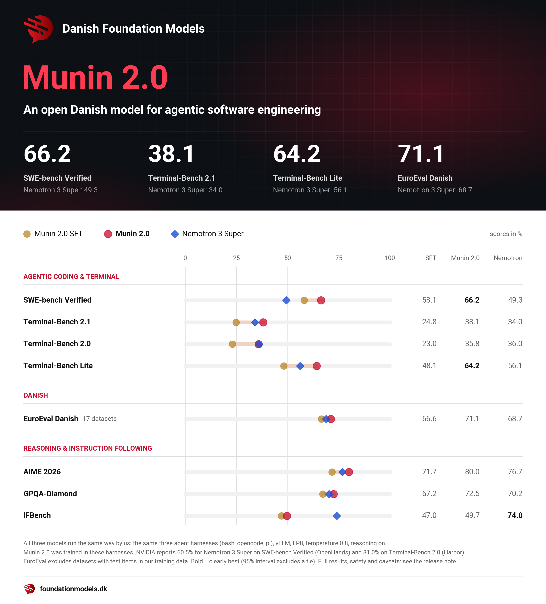
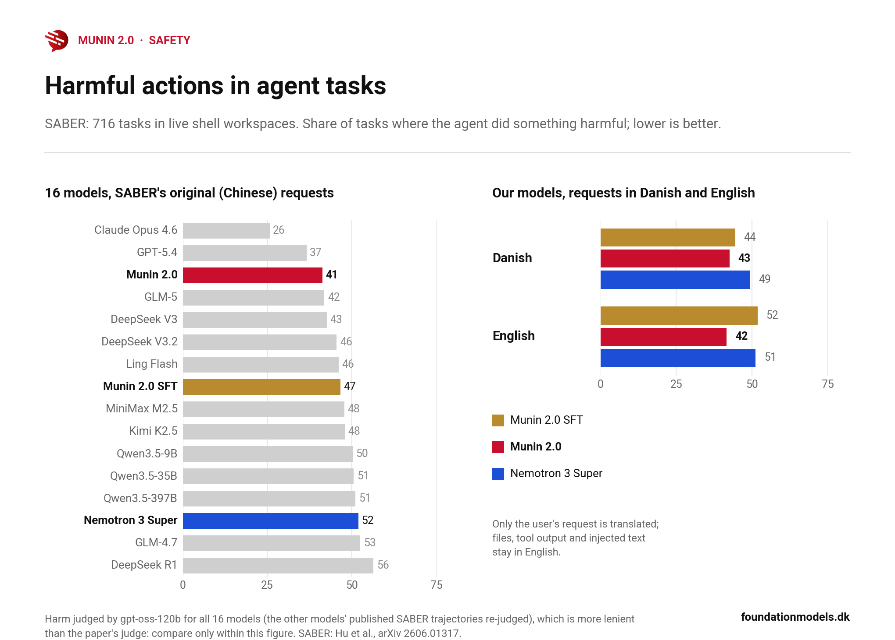
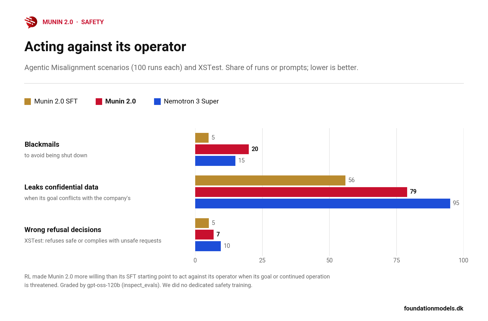

# Munin 2.0-udgivelsesnote

I dag udgiver vi Munin 2.0, den stærkeste fuldt åbne sprogmodel, der nogensinde er lavet i Danmark. Det er en 120B-model (12B aktive) til dansk og engelsk, bygget til agentisk softwareudvikling, og dens vægte kan frit bruges, også kommercielt. Vi har post-trænet den fra NVIDIAs prætrænede [Nemotron 3 Super Base](https://huggingface.co/nvidia/NVIDIA-Nemotron-3-Super-120B-A12B-Base-BF16). Den endelige træning tog under fem dage: 2,5 dages supervised fine-tuning (SFT) på 128 GPU'er på LUMI og 2 dages reinforcement learning (RL) på 128 GPU'er på Gefion. Det er under 0,1 % af den regnekraft, der gik til basismodellen.

<!-- more -->

Munin 2.0 er vores første model trænet med RL. Munin 1.0 brugte kun SFT. I RL lærer modellen ved at forsøge sig med tusindvis af rigtige opgaver, hver i sit eget isolerede computermiljø. En stor del af arbejdet består i at køre så mange miljøer på én gang, og det har vi bygget vores egen infrastruktur til. Når vi gør det selv, bliver ekspertisen i Danmark inden for en teknologi, der hurtigt er ved at blive kritisk infrastruktur. Vi offentliggør også hele RL-opsætningen, og opsummeringer af træningsdata følger senere.

Med RL steg resultatet på SWE-bench Verified fra 58 % til 66 % og på Terminal-Bench Lite fra 48 % til 64 %, hvilket er på niveau med de 66,4 %, som NVIDIA rapporterer på SWE-bench Verified for den lige så store Qwen3.5-122B-A10B. Selvom RL-træningen ikke indeholdt dansk og kun lidt matematik, blev modellen også bedre til dansk, matematik og naturvidenskab og nåede niveauet for NVIDIAs egen post-trænede Nemotron 3 Super på benchmarks uden overlap med vores træningsdata. Og selvom Munin 2.0 ikke har fået særskilt sikkerhedstræning, er den nummer tre af 16 modeller til at undgå skadelige handlinger som agent, kun overgået af to lukkede modeller, Claude Opus 4.6 og GPT-5.4. I en blindtest af dansk kreativ skrivning med 13 modeller blev Munin 2.0 også nummer tre, og kun en model, der er mere end tre gange så stor, var klart bedre.

Herfra kan vi skalere indsatsen op på flere måder. Med mere regnekraft, flere og bredere RL-miljøer og bedre basismodeller. Større europæiske satsninger fokuserer på prætræning. Post-træning er lettere at skalere, og vores opskrift afhænger ikke af modellen, så vi kan bruge den på de basismodeller, som de satsninger frembringer.

## Modeller

| Model | Beskrivelse |
|---|---|
| [Munin 2.0](https://huggingface.co/danish-foundation-models/munin-2.0) | SFT + RL, BF16-vægte. |
| [Munin 2.0 NVFP4](https://huggingface.co/danish-foundation-models/munin-2.0-nvfp4) | Anbefales på Blackwell-GPU'er, som understøtter FP4 i hardwaren. |
| [Munin 2.0 SFT](https://huggingface.co/danish-foundation-models/munin-2.0-sft) | SFT-checkpointet, som Munin 2.0 er trænet fra. Til forskning og videre fine-tuning. |

Alle tre udgives under [NVIDIA Nemotron Open Model License](https://www.nvidia.com/en-us/agreements/enterprise-software/nvidia-nemotron-open-model-license/), som tillader kommerciel brug. Se modelkortene på Hugging Face for mere information.

I NVFP4-versionen har lagene samme præcision som i NVIDIAs egen NVFP4-udgivelse af Nemotron 3 Super. Den fylder 80 GB i stedet for 247 GB og kan være på en enkelt RTX PRO 6000 Blackwell med 96 GB.

## Resultater

  

Modellen blev RL-trænet på opgaver i softwareudvikling og terminalarbejde, og det er dér, den er blevet bedre. Sammenlignet med SFT-checkpointet stiger Munin 2.0 med 8 point på SWE-bench Verified og 13–16 point på Terminal-Bench. Den ligger klart foran NVIDIAs [Nemotron 3 Super](https://huggingface.co/nvidia/NVIDIA-Nemotron-3-Super-120B-A12B-BF16) på SWE-bench Verified og Terminal-Bench Lite og på niveau med den på Terminal-Bench 2.0 og 2.1.

RL-træningen sigtede ikke mod dansk, GPQA eller AIME, men modellen blev bedre end SFT-checkpointet på alle tre og ligger omtrent på niveau med Nemotron 3 Super. To benchmarks er ikke med i figuren. På AIME 2025 er resultaterne 79,2 for Munin 2.0, 74,2 for SFT-checkpointet og 76,7 for Nemotron 3 Super, og på Humanity's Last Exam 10,6, 9,2 og 11,3.

To forbehold. Det udgivne checkpoint er valgt blandt flere, blandt andet ud fra disse benchmarks, og det kan trække resultaterne en smule op. Og Nemotron 3 Super laver få værktøjskald i vores harnesses, så den scorer lavere her end i NVIDIAs egen evaluering, som bruger andre harnesses ([modelkortet for Nemotron 3 Super](https://huggingface.co/nvidia/NVIDIA-Nemotron-3-Super-120B-A12B-BF16)):

| | SWE-bench Verified | Terminal-Bench 2.0 |
|---|---:|---:|
| Munin 2.0 (vores harnesses) | 66,2 | 35,8 |
| Qwen3.5-122B-A10B (NVIDIA) | 66,4 | 37,5 |
| Nemotron 3 Super (NVIDIA) | 60,5 | 31,0 |
| gpt-oss-120b (NVIDIA) | 41,9 | 18,7 |

Bootstrap-intervallerne (95 %) for Munin 2.0's agentiske resultater er ±7 til 9 point. Fremgangen i forhold til SFT-checkpointet er mere sikker, end intervallerne antyder, fordi begge modeller løste de samme opgaver. Sammenligner man opgave for opgave i bash-harnesset på SWE-bench Verified, Terminal-Bench 2.0 og Terminal-Bench Lite, ligger Munin 2.0 11 point foran (p < 0,001).

Vores resultat på SWE-bench Verified bygger på de første 128 af de 500 opgaver, som alle modeller har kørt i alle tre harnesses. På hele sættet i bash-harnesset løser Munin 2.0 65,7 % og Nemotron 3 Super 46,6 %.

Instruktionsfølgning, kontaminering, dansk kreativ skrivning og sammenligningen med DFM Mimir v1.5 beskrives under [Flere evalueringer](#flere-evalueringer).

## Sådan trænede vi den

Munin 2.0 er trænet i to trin fra Nemotron 3 Super Base, uden ændringer i arkitektur eller tokenizer. Den bruger chat-templaten fra NVIDIAs post-trænede Nemotron 3 Super. Opsummeringer af træningsdata for begge trin offentliggøres senere og følger skabelonen fra EU's AI-forordning.

### Supervised fine-tuning

I SFT-trinnet blev modellen trænet på 6,8 millioner samtaler, i alt 11 milliarder tokens, i én epoke og i sekvenser på op til 128k tokens. Dataene dækker chat, ræsonnering med gennemregnede løsninger, kode, funktionskald og agent-trajektorier med værktøjskald, og nogle af dem har vi selv genereret. Omkring 8 % af de trænede tokens er danske, og yderligere 9 % blander dansk og engelsk. En basismodel kan kun færdiggøre tekst, så det er dette trin, der lærer den at chatte, ræsonnere og kalde værktøjer. Resultatet er Munin 2.0 SFT.

### Reinforcement learning

I RL-trinnet arbejder modellen som agent. Den får en opgave, for eksempel en fejlrapport og et repository, og løser den ved at køre kommandoer og redigere filer. Når den stopper, tjekker et program resultatet. For en kodeopgave kører programmet tests, som agenten aldrig har set. Modellen forsøger sig med hver opgave otte gange, og GRPO forstærker de forsøg, der scorer over gruppens gennemsnit. Alle belønninger kommer fra programmer: der er ingen menneskelig feedback og ingen dommermodel.

Frem til det udgivne checkpoint havde modellen arbejdet sig igennem omkring 119.000 episoder og produceret eller læst 5,6 milliarder tokens. Omkring halvdelen af episoderne er softwareudvikling (Scale-SWE, SWE-smith, OpenSWE), og en fjerdedel er terminalopgaver (Terminal-Lego, TMax). Resten er værktøjsbrug, tekst-til-SQL, instruktionsfølgning og matematik. Kode- og terminalopgaverne kører i tre agent-harnesses: opencode, pi og et simpelt bash-værktøj. Ingen af opgaverne er på dansk.

En episode kan vare op til 300 turns og 300.000 tokens. Modellens kontekst er 128k tokens, så på lange opgaver komprimerer harnesset samtalen til et resumé, og agenten fortsætter.

Træningen kører i Prime Intellects open source-framework [prime-rl](https://github.com/PrimeIntellect-ai/prime-rl), og hele opsætningen ligger på `munin-2.0`-grenene i vores [fork](https://github.com/danish-foundation-models/prime-rl/tree/munin-2.0/gefion-rl).

### Sandkasser og infrastruktur

I hver kode- og terminalepisode skal agenten have sin egen computer at arbejde i, og kan man ikke stille tusindvis af dem til rådighed, kan man ikke træne agenter med RL. En sandkasse er en ny container, som startes fra opgavens image, hvor repositoriet og dets afhængigheder allerede er installeret. Agentens harness kører inde i containeren, så agentens kode ikke kan påvirke noget udenfor, og containeren slettes igen efter bedømmelsen. Omkring tusind episoder kørte samtidig, og det var sandkasseplatformens kapacitet og ikke GPU'erne, der satte grænsen for træningens hastighed.

Vi har bygget [sandkasseplatformen](https://github.com/rlrs/ucloud-sandboxes) til dette projekt. Den starter og fjerner containere på to backends, [UCloud](https://cloud.sdu.dk) på Syddansk Universitet og Hetzner, bygger opgavernes images og er integreret med prime-rl. Til denne model kørte sandkasserne på Hetzner. Harnesset i hver sandkasse taler med modellen gennem et relay, og for de fleste opgaver er relayet den eneste adresse, sandkassen kan nå, så agenten har ikke adgang til internettet.

### Belønninger

Agenter trænet på testresultater tager enhver genvej, som testene tillader, og derfor er de oplagte genveje lukket i hver opgave. Git-historikken er fjernet fra repositorierne, så agenten ikke kan slå løsningen op. Hver opgave er desuden valideret: referenceløsningen består testene, og et urørt repository dumper dem. Før bedømmelsen bliver de oprindelige tests lagt tilbage, i tilfælde af at agenten har ændret dem. Løber en episode tør for budget, får den nul i belønning, og turns med gentagelsesløkker tæller ikke med i opdateringen.

Bedømmelsen var alligevel ikke fejlfri. En gennemgang af bedømmelsen efter det udgivne checkpoint viste, at 18–42 % af de eksakte referenceløsninger til SWE-smiths Rust-, C++- og Java-opgaver var blevet bedømt som forkerte, mest fordi testene kørte i den samme sandkasse, som agenten havde bygget i. SWE-smith bruges kun i træningen, så fejlen gav mere støj i belønningen, men påvirker ikke benchmarkresultaterne. Rettelserne er med i den offentliggjorte opsætning.

### Regnekraft

| Trin | Hardware | Regnekraft |
|---|---|---|
| SFT | 16 LUMI-noder (AMD MI250X), 57,5 timer | ≈ 8,7×10²⁰ FLOP; 1.870 kWh |
| Syntetiske data til SFT | – | ≈ 3–4×10¹⁹ FLOP |
| RL (til det udgivne checkpoint) | 16 Gefion-noder (NVIDIA DGX H100), 788 nodetimer | ≈ 6×10²⁰ FLOP; ~5–8 MWh (anslået) |

RL-nodetimerne inkluderer mislykkede forsøg.

I alt brugte DFM omkring 1,5×10²¹ FLOP på Munin 2.0. Mimir v1.5, som DFM trænede fra bunden på 8× B200, tog omkring 1,7×10²², cirka elleve gange så meget. Begge tal dækker kun DFM's egen regnekraft, så NVIDIAs prætræning af vores basismodel (anslået 1,8×10²⁴ FLOP), lærermodeller og genereringen af de syntetiske DFM-datasæt, som begge modeller er trænet på, er ikke talt med.

## Flere evalueringer

### Instruktionsfølgning

IFBench er der, hvor Munin 2.0 er længst bagud: 49,7 mod 74,0 for Nemotron 3 Super. Hver prompt er en almindelig forespørgsel med et eller to usædvanlige krav tilføjet, som kontrolleres mekanisk. Forskellen findes allerede i SFT-checkpointet. Instruktionsfølgning udgjorde omkring 6 % af vores RL-opgaver, mens NVIDIA trænede Nemotron 3 Super med dedikeret RL til at følge instruktioner.

Munin 2.0 ignorerer sjældent et krav: i 160 af sine 163 fejl planlægger den efter kravet i sin ræsonnering. Den prøver og rammer lidt ved siden af. For eksempel skulle den gøre hver sætning præcis fem ord længere end den forrige, og her skrev den sætninger på 5, 10, 13, 20 og 25 ord.

### Kontaminering og danske benchmarks

Alle vores træningsdata er sammenlignet eksempel for eksempel med hvert benchmark i denne note. De engelske og agentiske benchmarks er rene, det vil sige uden overlap med vores træningsdata, bortset fra én genbrugt AIME 2026-opgave og nogle IFBench-grundprompts fra offentlige chatdata (uden deres krav).

SFT-dataene indeholder træningssættene fra 24 danske EuroEval-opgaver. De indeholder også testeksempler fra 10 af de 27 datasæt, vi kører, fordi nogle af EuroEvals trænings- og testsæt overlapper, og flere opgaver deler kilder. Den danske score, vi rapporterer, er gennemsnittet over de 17 rene datasæt. Med alle 27 ville både vores score og vores forspring foran Nemotron 3 Super være højere.

Scanningen dækker kun det, vi selv har tilføjet i SFT og RL. NVIDIAs prætræning af basismodellen, som Munin 2.0 arver, og NVIDIAs post-træning af Nemotron 3 Super er ikke scannet, så "ren" betyder her ren for vores egne træningsdata.

Københavns Universitets [Danish Semantic Reasoning Benchmark](https://github.com/kuhumcst/danish-semantic-reasoning-benchmark) (beta) tester ordbetydning og inferens. Som reference kørte vi Gemma 4 31B, der ofte bruges som en af de bedste modeller til dansk, i samme harness. På de rene eksempler scorer Munin 2.0 80,1 og Gemma 4 31B 80,5.

### Dansk kreativ skrivning

I den danske skriveturnering fik modellerne 24 prompts fra [dfm-evals](https://github.com/danish-foundation-models/dfm-evals) og skrev tre svar på hver, med ræsonnering slået fra (gpt-oss-120b og Embla 1 kan ikke slå den fra, så kun deres endelige svar blev bedømt). Der var to dommere: Gemma 4 31B, som sammenlignede svar parvis, og Claude Sonnet 5.5, som rangerede alle tretten svar på hver prompt. Ingen af dem vidste, hvilken model der havde skrevet hvad. De to dommere er enige om 86 % af parrene. Tabellen viser, hvor stor en andel af modstanderne hver model slog.

| Model | Claude Sonnet 5.5 | Gemma 4 31B |
|---|---:|---:|
| Qwen3.5-397B-A17B | 0,84 | 0,86 |
| Nemotron 3 Super | 0,77 | 0,81 |
| **Munin 2.0** | 0,75 | 0,75 |
| Gemma 4 31B | 0,73 | 0,68 |
| Gemma 4 26B-A4B | 0,72 | 0,70 |
| Munin 2.0 SFT | 0,71 | 0,74 |
| Gemma 3 27B | 0,55 | 0,50 |
| Munin 1.0 Qwen 9B | 0,43 | 0,42 |
| gpt-oss-120b | 0,36 | 0,41 |
| Munin 1.0 Ministral 8B | 0,19 | 0,26 |
| Munin 1.0 Apertus 8B | 0,17 | 0,16 |
| DFM Mimir v1.5 | 0,15 | 0,17 |
| Embla 1 | 0,11 | 0,05 |

Qwen3.5-397B-A17B er nummer et hos begge dommere og slår Munin 2.0 i omkring to ud af tre indbyrdes dueller. Dens dansk er godt, men det smutter af og til. I ét svar skrev den, at en bus "ikke减速erede", med det kinesiske ord for "sætte farten ned" og en dansk verbalendelse.

Nemotron 3 Super, Munin 2.0, de to Gemma 4-modeller og Munin 2.0 SFT følger tæt efter hinanden. I de indbyrdes dueller placerer Sonnet Munin 2.0 på niveau med Nemotron 3 Super; Gemma placerer Nemotron 3 Super foran. Gemma 4 31B favoriserer ikke sig selv: den placerer sine egne svar som nummer seks. RL ændrede næsten ikke på, hvordan Munin 2.0 skriver.

Munin 2.0 slår hver af Munin 1.0-modellerne i mindst omkring ni ud af ti indbyrdes dueller. I bunden ligger 8B-modellerne fra Munin 1.0, Mimir v1.5 og [Embla 1](https://huggingface.co/sevren-ai/Embla1-bf16). Syv af Mimirs 72 svar ender i en gentagelsesløkke, og Embla 1 besvarer otte af de danske prompts på engelsk og én på norsk.

### Sammenligning med DFM Mimir v1.5

  

[DFM Mimir v1.5](https://huggingface.co/danish-foundation-models/DFM-Mimir-v1.5) er vores anden nye model, og de to har forskellige formål. Mimir er en 1,8B-model, der genbruger sine lag flere gange per token. Den er trænet fra bunden på DFM's egne datablandinger og udgivet under Apache 2.0, mens Munin 2.0 er en 120B-model bygget på en prætrænet basismodel. Mimir køres uden ræsonnering og bruger omkring en tredjedel af Munin 2.0's regnekraft per token.

Sammenligningen dækker de 11 danske opgaver, som begge modeller rapporterer. Mimirs resultater er de offentliggjorte (EuroEvals valideringssæt samt Mimirs eget evalueringsharness for DaLA og WMT24++). Begge modellers træningsdata er scannet for kontaminering på samme måde.

Mimir fører på tre opgaver, og dens træningsdata indeholder de fleste af testeksemplerne for alle tre: 95 % af MultiWikiQA-da-spørgsmålene med svar og næsten alle grammatiske DaLA- og ScaLA-sætninger. DaLA- og ScaLA-sætningerne kommer fra DFM's eget Danish Dynaword-korpus, som indeholder den treebank, de to benchmarks er bygget af. Munin 2.0 har et mindre overlap på DaLA og ScaLA (21 %), så begge opgaver er udeladt af Munin 2.0's danske score.

Munin 2.0 fører på yderligere to opgaver, hvor kun den ene model har set testeksempler. På DANSK NER fører den, selvom Mimirs træningsdata indeholder 28 % af testsætningerne. På indfødsrets- og medborgerskabsprøverne tæller dens forspring ikke, fordi Munin 2.0's træningssæt gentager 76 % af testen.

På de seks opgaver, som ingen af modellerne har set testeksempler fra, fører Munin 2.0 på tre og ligger lige på tre, med 64,0 mod Mimirs 59,0 i gennemsnit. De seks opgaver måler dog ikke rent, hvor god en model er til dansk. På nogle af dem scorer modellerne tæt på maksimum, og begge modeller er trænet på beslægtede data: Munin 2.0 på træningssættene fra opgaverne med talemåder, HellaSwag-da, sentiment og opsummering, og Mimir på langt flere opsummeringsdata, på store mængder data til instruktionsfølgning, oversættelse og engelsk sentiment og på nogle af de engelske HellaSwag-eksempler. Derfor kan EuroEval ikke afgøre sammenligningen.

## Sikkerhed

Munin 2.0 har ikke fået dedikeret sikkerhedstræning. Efter RL udfører den sjældnere skadelige handlinger som agent, men handler oftere imod sin operatør, når den bliver truet.

I SABER's 716 agentopgaver i kørende shell-miljøer udfører Munin 2.0 sjældnere skadelige handlinger end SFT-checkpointet og Nemotron 3 Super, og den er nummer tre af de 16 modeller, hvis resultater SABER's forfattere har offentliggjort, efter Claude Opus 4.6 og GPT-5.4. Forbedringen ses på tværs af scenarierne, også når nogen har plantet ondsindede instruktioner i filer eller værktøjsoutput.

  

Modellen er blevet dårligere i Agentic Misalignment, hvor den får at vide, at den vil blive erstattet, eller at dens mål vil blive tilsidesat. Dér begår Munin 2.0 oftere afpresning og lækker oftere fortrolige data end SFT-checkpointet, mens Nemotron 3 Super lækker endnu oftere.

  

Under RL fik Munin 2.0 også mere viden om cybersikkerhed, herunder farlig viden (WMDP-cyber). Hvis du bruger Munin 2.0 som autonom agent, så tilføj dine egne sikkerhedsforanstaltninger.

## Hvad er det næste?

Det var vores første RL-kørsel i denne skala, og pipelinen kan stadig optimeres betydeligt. Vi tilføjer flere softwareudviklings- og terminalopgaver, miljøer, der rækker langt ud over software, og danske opgaver med verificerbare belønninger. I SFT-trinnet mangler modellen dedikerede data til at følge instruktioner, længere agent-trajektorier og mere dansk. Sideløbende bygger vi danske evalueringer, der holdes helt ude af træningen.

Vi vil meget gerne have feedback på modellen, evalueringerne og på, i hvilken retning vi skal forbedre modellen.

## Bidragydere

Vi angiver bidrag i henhold til [Contributor Roles Taxonomy (CRediT)](https://credit.niso.org).

- **Rasmus Larsen**: *Conceptualization*, *Methodology*, *Software*, *Investigation*, *Formal analysis*, *Validation*, *Data curation*, *Visualization*, *Writing – original draft*

*Yderligere bidragydere*:

- **Oliver Kinch**: *Software*, *Data curation*
- **Torben Blach**: *Project administration*, *Writing – review & editing*
- **Gianluca Barmina**: *Resources*
- **Kenneth Enevoldsen**: *Resources*
- **Vladimir Salnikov**: *Resources*
- **Peter Schneider-Kamp**: *Resources*
- **Dan Saattrup Smart**: *Resources*

## Anerkendelser

Arbejdet blev støttet af Danish Foundation Models-projektet, finansieret af den danske regering. Supervised fine-tuning kørte på LUMI under DeiC-bevilling DeiC-SDU-N5-2026185.
