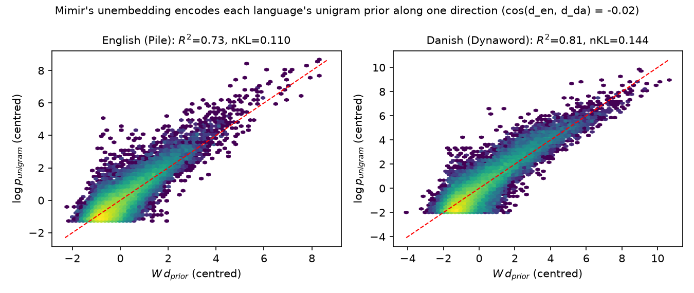
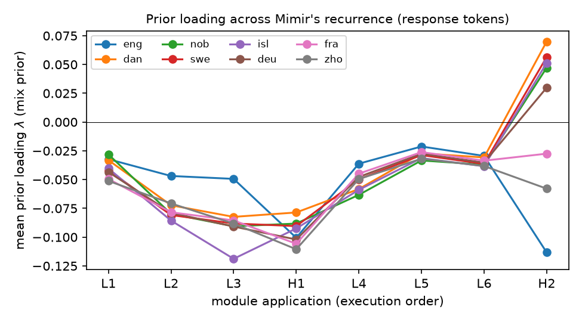

# What does Mimir fall back on when it doesn't know?

What does a language model predict when the context gives it few clues? A recent paper,
[The Geometry of Ignorance (Liu et al., 2026)](https://arxiv.org/abs/2609.02959), argues that it falls back on how common
each word is. This fallback, the model's *prior*, is stored along a single direction of the model's output layer,
the *direction of ignorance*. How strongly a prediction points along that direction (written λ) tells you how much
the model relies on the prior. We tested the idea on [DFM Mimir](https://huggingface.co/danish-foundation-models/DFM-Mimir)
while it solved math word problems from [multilingual GSM-symbolic](https://github.com/centre-for-humanities-computing/multilingual-gsm-symbolic)
in eight languages.

  <a class="md-button md-button--primary" href="https://github.com/KennethEnevoldsen/mimirs-geometry-of-ignorance">Code, data and full results →</a>

<!-- more -->

## One prior per language

The original paper studied English-dominant models, where a single direction captures the prior. Mimir is
bilingual, and it turns out to store **two** priors: one direction reconstructs English word frequencies
(R² = 0.73) and another reconstructs Danish ones (R² = 0.81). The two directions are orthogonal
(cosine similarity −0.02). A randomly initialised model gives R² = 0.05, so this structure comes from training.

{ style="display: block; margin: 0 auto;" }

## The direction does something

If we push Mimir's internal state along the direction of ignorance at a token where it is uncertain, its prediction
moves toward the plain word-frequency distribution. Pushing it the same distance in a random direction does not.
This matches the causal result in the original paper.

{ style="display: block; margin: 0 auto;" }

## Mimir barely leans on the prior when doing math

While solving problems, Mimir uses almost none of the prior (|λ| ≤ 0.12, against roughly 0.4 for Llama‑3.2‑3B on
Wikipedia text). What little it uses matches the answer's language: Danish, Norwegian and Swedish answers lean on
the Danish prior, and English answers on the English one. Mimir is a *Hierarchical Reasoning Model* that applies the
same blocks several times. The language-specific prior only shows up in the very last pass; every earlier pass
pushes *away* from the prior.

{ style="display: block; margin: 0 auto;" }

## What we did not find, and what we found instead

The paper suggests λ could work as a warning sign for hallucinations. On math problems it does not: λ separates
right from wrong answers no better than chance (AUROC 0.52), while the model's plain uncertainty (entropy) does
much better (0.73).

The experiment did turn up something we can act on. **In Danish, Norwegian and Icelandic, Mimir sometimes skips the
reasoning and writes the answer straight away** (32%, 52% and 35% of the problems). Those answers are mostly wrong.
When Mimir does work through the problem, it solves 89% of the Danish and 93% of the Norwegian ones, close to its
92% in English, where it never skips the reasoning. This tells us what to fix in the next version of Mimir.

All code, generations and figures are on [GitHub](https://github.com/KennethEnevoldsen/mimirs-geometry-of-ignorance),
and everything can be reproduced with a single script.
