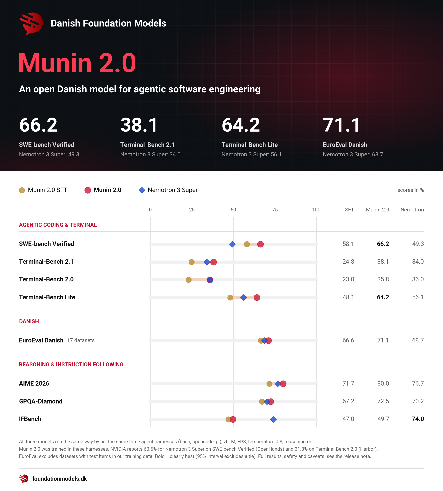
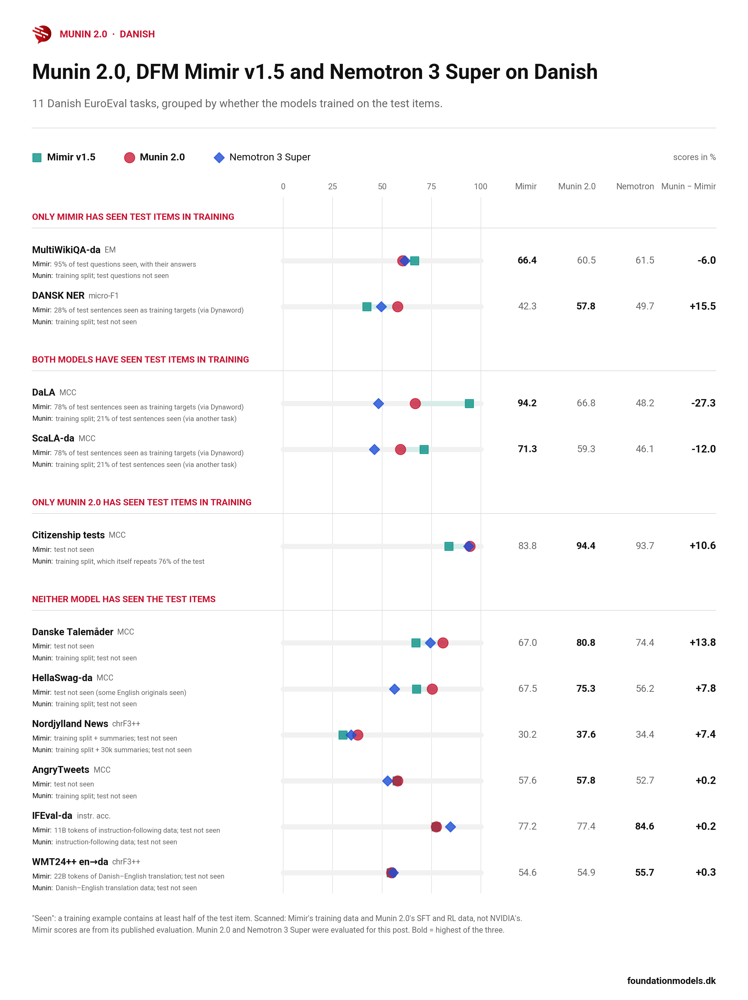
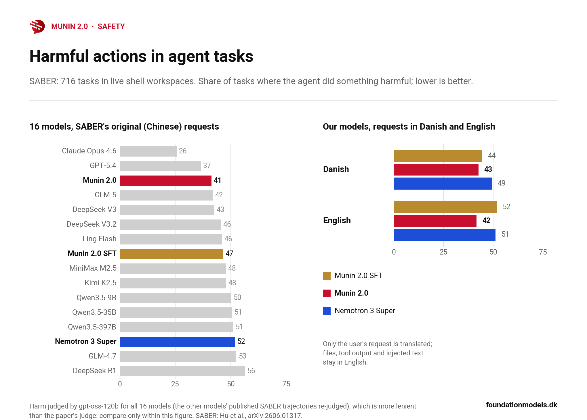
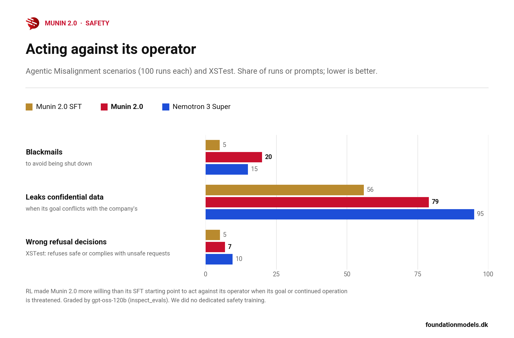

# Munin 2.0 release note

Today we release Munin 2.0, the most capable fully open language model ever made in Denmark. It is a 120B model (12B active) for Danish and English, built for agentic software engineering, and its weights are free to use, also commercially. We post-trained it from NVIDIA's pretrained [Nemotron 3 Super Base](https://huggingface.co/nvidia/NVIDIA-Nemotron-3-Super-120B-A12B-Base-BF16) in under five days of final training: 2.5 days of supervised fine-tuning (SFT) on 128 GPUs on LUMI and 2 days of reinforcement learning (RL) on 128 GPUs on Gefion, under 0.1% of the compute that went into the base model.

<!-- more -->

Munin 2.0 is our first model trained with RL. Munin 1.0 used SFT only. In RL the model learns by attempting thousands of real tasks, each in its own isolated computer environment. Running those environments at scale is much of the work, and we built our own infrastructure for it. Doing this ourselves keeps the know-how in Denmark for a technology that is quickly becoming critical infrastructure. We publish the full RL setup, and summaries of the training data will follow.

RL took SWE-bench Verified from 58% to 66% and Terminal-Bench Lite from 48% to 64%, on par with the 66.4% on SWE-bench Verified that NVIDIA reports for the same-size Qwen3.5-122B-A10B. The RL had no Danish and little maths, yet Danish, maths and science improved too, to the level of NVIDIA's own post-trained Nemotron 3 Super, measured on benchmarks clean of our training data. Without any dedicated safety training, Munin 2.0 ranks third of 16 models at avoiding harmful actions as an agent, behind only two closed frontier models. We also ran a blind comparison of Danish creative writing across 13 models. Munin 2.0 came third, and only a model more than three times its size was clearly better.

From here, we can scale this in several ways: more compute, more and broader RL environments, and better base models. Larger European efforts focus on pretraining; post-training scales more easily, and because our recipe is model-agnostic, we can apply it to whatever base models those efforts produce.

## Models

| Model | What it is |
|---|---|
| [Munin 2.0](https://huggingface.co/danish-foundation-models/munin-2.0) | SFT + RL, BF16 weights. |
| [Munin 2.0 NVFP4](https://huggingface.co/danish-foundation-models/munin-2.0-nvfp4) | Recommended on Blackwell GPUs, which run FP4 natively. |
| [Munin 2.0 SFT](https://huggingface.co/danish-foundation-models/munin-2.0-sft) | The SFT checkpoint Munin 2.0 was trained from. For research and further fine-tuning. |

All three are released under the [NVIDIA Nemotron Open Model License](https://www.nvidia.com/en-us/agreements/enterprise-software/nvidia-nemotron-open-model-license/), which allows commercial use. See the model cards on Hugging Face for more information.

The NVFP4 version uses the same mixed-precision layout as NVIDIA's own NVFP4 release of Nemotron 3 Super. It is 80 GB instead of 247 GB and fits on a single 96 GB RTX PRO 6000 Blackwell.

## Results

  

The RL was on software engineering and terminal tasks, and that is where the gains are. Compared with the SFT checkpoint, Munin 2.0 gains 8 points on SWE-bench Verified and 13–16 points on Terminal-Bench. It is clearly ahead of NVIDIA's [Nemotron 3 Super](https://huggingface.co/nvidia/NVIDIA-Nemotron-3-Super-120B-A12B-BF16) on SWE-bench Verified and Terminal-Bench Lite, and level on Terminal-Bench 2.0 and 2.1.

Danish, GPQA and AIME were not targets of the RL, but all three improved over the SFT checkpoint, to roughly Nemotron 3 Super's level. Two benchmarks are not in the figure. On AIME 2025 the scores are 79.2 for Munin 2.0, 74.2 for the SFT checkpoint and 76.7 for Nemotron 3 Super, and on Humanity's Last Exam 10.6, 9.2 and 11.3.

Two caveats. The released checkpoint was chosen partly on these benchmarks, so its scores on them are somewhat optimistic. And Nemotron 3 Super makes few tool calls in our harnesses, so it scores lower here than in NVIDIA's own evaluation, which uses other harnesses ([Nemotron 3 Super model card](https://huggingface.co/nvidia/NVIDIA-Nemotron-3-Super-120B-A12B-BF16)):

| | SWE-bench Verified | Terminal-Bench 2.0 |
|---|---:|---:|
| Munin 2.0 (our harnesses) | 66.2 | 35.8 |
| Qwen3.5-122B-A10B (NVIDIA) | 66.4 | 37.5 |
| Nemotron 3 Super (NVIDIA) | 60.5 | 31.0 |
| gpt-oss-120b (NVIDIA) | 41.9 | 18.7 |

The 95% bootstrap intervals on Munin 2.0's agentic scores are ±7 to 9 points. The gain over the SFT checkpoint is more certain than that, because both ran the same tasks. Compared task by task in the bash harness, across SWE-bench Verified, Terminal-Bench 2.0 and Terminal-Bench Lite, Munin 2.0 is 11 points ahead (p < 0.001).

Our SWE-bench Verified score is on the first 128 of the 500 tasks, which every model ran in all three harnesses. On the full set in the bash harness, Munin 2.0 solves 65.7% and Nemotron 3 Super 46.6%.

Instruction following, contamination, Danish creative writing and the comparison with DFM Mimir v1.5 are covered under [More evaluations](#more-evaluations).

## How we trained it

Munin 2.0 was trained in two stages from Nemotron 3 Super Base, with the architecture, tokenizer and chat template unchanged. Summaries of the training data for both stages, following the EU AI Act template, will be published later.

### Supervised fine-tuning

The SFT stage was one pass over 6.8 million conversations, 11 billion tokens, in sequences of up to 128k tokens. The mixture covers chat, reasoning with worked solutions, code, function calling and agent trajectories with tool calls, some of which we generated ourselves. About 8% of the trained tokens are Danish and another 9% mix Danish and English. A base model only continues text; this stage teaches it to chat, reason and call tools. The result is Munin 2.0 SFT.

### Reinforcement learning

In the RL stage the model works as an agent. It gets a task, such as a bug report and a repository, and solves it by running commands and editing files. When it stops, a program checks the result. For a coding task, that means running tests the agent never saw. The model attempts each task eight times, and GRPO reinforces the attempts that score above the group's average. All rewards come from programs: there is no human feedback and no judge model.

By the released checkpoint the model had worked through about 119,000 episodes, producing or reading 5.6 billion tokens. About half of the episodes are software engineering (Scale-SWE, SWE-smith, OpenSWE) and a quarter are terminal tasks (Terminal-Lego, TMax). The rest are tool use, text-to-SQL, instruction following and maths. The coding and terminal tasks run in three agent harnesses: opencode, pi and a plain bash tool. None of the tasks are in Danish.

An episode can run for up to 300 turns and 300,000 tokens. The model's context is 128k tokens, so on long tasks the harness compacts the conversation into a summary and the agent carries on.

The training framework is Prime Intellect's open-source [prime-rl](https://github.com/PrimeIntellect-ai/prime-rl), and the full setup is on the `munin-2.0` branches of our [fork](https://github.com/danish-foundation-models/prime-rl/tree/munin-2.0/gefion-rl).

### Sandboxes and infrastructure

Every coding and terminal episode needs its own computer for the agent to work in, and RL on agent tasks is not possible without a service that can supply thousands of them at once. A sandbox is a fresh container started from the task's image, with the repository and its dependencies installed. The agent harness runs inside it, so whatever code the agent executes cannot affect anything outside, and when the episode has been graded the container is thrown away. Around a thousand episodes ran at once, and it was the sandbox service, not the GPUs, that limited how fast training could go.

We built the [sandbox service](https://github.com/rlrs/ucloud-sandboxes) for this project. It starts and removes containers on either of two backends, [UCloud](https://cloud.sdu.dk) at the University of Southern Denmark and Hetzner, builds the task images, and plugs into prime-rl. For this model the sandboxes ran on Hetzner. The harness in each sandbox reaches the model through a relay, and for most tasks the relay is the only address a sandbox can reach, so the agent has no internet access.

### Rewards

An agent trained on test results will take any shortcut the tests allow, so each task is set up to close the obvious ones. Git history is removed from the repositories so the agent cannot look up the fix, and every task is validated: the reference fix passes and an untouched repository fails. Before grading, the original tests are put back in case the agent changed them. Episodes that run out of budget get zero reward, and turns that end in a repetition loop are left out of the update.

Grading was still noisy. An audit after the released checkpoint showed that for SWE-smith's Rust, C++ and Java tasks, 18–42% of exact reference fixes had been scored as failures, mostly because the tests ran in the same sandbox the agent had been building in. SWE-smith is used only in training, so this made the reward noisier but does not affect the benchmark results. The fixes are in the published setup.

### Compute

| Stage | Hardware | Compute |
|---|---|---|
| SFT | 16 LUMI nodes (AMD MI250X), 57.5 hours | ≈ 8.7×10²⁰ FLOP; 1,870 kWh |
| Synthetic data for the SFT | n/a | ≈ 3–4×10¹⁹ FLOP |
| RL (to the released checkpoint) | 16 Gefion nodes (NVIDIA DGX H100), 788 node-hours | ≈ 6×10²⁰ FLOP; ~5–8 MWh (estimated) |

The RL node-hours include failed attempts.

In total, DFM spent about 1.5×10²¹ FLOP on Munin 2.0. Mimir v1.5, which DFM trained from scratch on 8× B200, took about 1.7×10²², roughly eleven times as much. Both figures count only DFM's own compute: not NVIDIA's pretraining of our base model (an estimated 1.8×10²⁴ FLOP), teacher models, or the synthetic datasets shared within DFM.

## More evaluations

### Instruction following

IFBench is where Munin 2.0 falls furthest behind: 49.7 against 74.0 for Nemotron 3 Super. Each prompt is an ordinary request with one or two unusual, mechanically checked constraints attached. The gap is already in the SFT checkpoint. Instruction-following prompts were about 6% of our RL tasks, while NVIDIA trained Nemotron 3 Super with dedicated instruction-following RL.

Munin 2.0 rarely ignores a constraint: its reasoning plans for it in 160 of its 163 failures. It tries and gets it slightly wrong. For example, asked to make each sentence exactly five words longer than the last, it wrote sentences of 5, 10, 13, 20 and 25 words.

### Contamination and Danish benchmarks

All of our training data was scanned, item by item, against every benchmark reported here. The English and agentic benchmarks are clean, apart from one reused AIME 2026 problem and some IFBench base prompts from public chat data (without their constraints).

The SFT data includes the training splits of 24 Danish EuroEval tasks. It also contains test items from 10 of the 27 datasets we run, because some of EuroEval's train and test splits overlap and several tasks share sources. The Danish score we report is the mean over the 17 clean datasets. With all 27, our score and our lead over Nemotron 3 Super would both be higher.

The scan covers only what we added in SFT and RL. NVIDIA's pretraining of the base model, which Munin 2.0 inherits, and its post-training of Nemotron 3 Super have not been scanned, so "clean" here means clean of our own training data.

The University of Copenhagen's [Danish Semantic Reasoning Benchmark](https://github.com/kuhumcst/danish-semantic-reasoning-benchmark) (beta) tests word meaning and inference. As a reference we ran Gemma 4 31B, which is widely used as one of the best models for Danish, in the same harness. On the items clean of our training data, Munin 2.0 scores 80.1 and Gemma 4 31B 80.5.

### Danish creative writing

The Danish writing tournament uses 24 prompts from [dfm-evals](https://github.com/danish-foundation-models/dfm-evals), three answers per prompt, with reasoning off (gpt-oss-120b and Embla 1 cannot turn it off, so only their final answers were judged). There were two judges: Gemma 4 31B, which compared answers in pairs, and Claude Sonnet 5.5, which ranked all thirteen answers to each prompt. Neither knew which model wrote which. The two judges agree on 86% of pairs. The table shows the share of opponents each model beat.

| Model | Claude Sonnet 5.5 | Gemma 4 31B |
|---|---:|---:|
| Qwen3.5-397B-A17B | 0.84 | 0.86 |
| Nemotron 3 Super | 0.77 | 0.81 |
| **Munin 2.0** | 0.75 | 0.75 |
| Gemma 4 31B | 0.73 | 0.68 |
| Gemma 4 26B-A4B | 0.72 | 0.70 |
| Munin 2.0 SFT | 0.71 | 0.74 |
| Gemma 3 27B | 0.55 | 0.50 |
| Munin 1.0 Qwen 9B | 0.43 | 0.42 |
| gpt-oss-120b | 0.36 | 0.41 |
| Munin 1.0 Ministral 8B | 0.19 | 0.26 |
| Munin 1.0 Apertus 8B | 0.17 | 0.16 |
| DFM Mimir v1.5 | 0.15 | 0.17 |
| Embla 1 | 0.11 | 0.05 |

Qwen3.5-397B-A17B is first under both judges and beats Munin 2.0 in about two of three head-to-heads. Its Danish is good, though it does slip now and then: in one answer it wrote that a bus "ikke减速erede", using the Chinese word for "slow down" with a Danish verb ending.

Nemotron 3 Super, Munin 2.0, the two Gemma 4 models and Munin 2.0 SFT follow close together. Head to head, Sonnet puts Munin 2.0 level with Nemotron 3 Super; Gemma puts Nemotron 3 Super ahead. Gemma 4 31B does not favour itself: it ranks its own answers sixth. RL barely changed how Munin 2.0 writes.

Munin 2.0 beats each Munin 1.0 model in about nine of ten head-to-heads or more. At the bottom are the 8B Munin 1.0 models, Mimir v1.5 and [Embla 1](https://huggingface.co/sevren-ai/Embla1-bf16). Seven of Mimir's 72 answers fall into a repetition loop, and Embla 1 answers eight of the Danish prompts in English and one in Norwegian.

### Comparison with DFM Mimir v1.5

  

[DFM Mimir v1.5](https://huggingface.co/danish-foundation-models/DFM-Mimir-v1.5) is our other recent model, and the two have different aims. Mimir is a 1.8B model that reuses its layers several times per token, trained from scratch on DFM's own data mixtures and released under Apache 2.0. Munin 2.0 is a 120B model built on a pretrained base. Mimir is run without reasoning and uses roughly a third of Munin 2.0's compute per token.

The comparison covers the 11 Danish tasks both models report. Mimir's scores are its published ones (EuroEval validation split, plus Mimir's evaluation harness for DaLA and WMT24++). The same contamination scan was run over both models' training data.

Mimir leads on three tasks, and its training data contains most of the test items for all three: 95% of the MultiWikiQA-da questions with answers, and almost every grammatical DaLA and ScaLA sentence. The DaLA and ScaLA sentences come from DFM's own Danish Dynaword corpus, which includes the treebank these benchmarks are built from. Munin 2.0 has a smaller overlap on DaLA and ScaLA (21%), so both tasks are left out of Munin 2.0's Danish score.

Munin 2.0 leads on two more tasks where only one model has seen test items. On DANSK NER it leads although Mimir's training data contains 28% of the test sentences. On the citizenship tests its lead does not count, because Munin 2.0's training split repeats 76% of the test.

On the six tasks neither model has seen, Munin 2.0 leads on three and is level on three, scoring 64.0 against Mimir's 59.0 on average. These six tasks don't cleanly measure Danish ability, though. On some of them the models score close to the maximum, and both models trained on related data: Munin 2.0 on the training splits of the idioms, HellaSwag-da, sentiment and summarisation tasks, and Mimir on far more summarisation data, on large amounts of instruction-following, translation and English sentiment data, and on some of the English HellaSwag items. So EuroEval can't settle this comparison.

## Safety

Munin 2.0 had no dedicated safety training. After RL, it takes harmful actions less often as an agent, but acts against its operator more often when it is threatened.

In SABER's 716 agent tasks in live shell workspaces, Munin 2.0 takes harmful actions less often than the SFT checkpoint and Nemotron 3 Super, and ranks third of the 16 models whose results SABER's authors published, behind Claude Opus 4.6 and GPT-5.4. The improvement holds across scenarios, including malicious instructions planted in files or tool output.

  

The regression is in Agentic Misalignment, where the model learns that it will be replaced or that its goal will be overridden. There Munin 2.0 blackmails and leaks confidential data more often than the SFT checkpoint. Nemotron 3 Super leaks even more often.

  

Munin 2.0's cyber-security knowledge also went up during RL, including hazardous knowledge (WMDP-cyber). If you deploy Munin 2.0 as an autonomous agent, add your own safeguards.

## What's next

This was our first RL run at this scale, and the pipeline can still be optimized significantly. We are adding more software engineering and terminal tasks, environments well beyond software, and Danish tasks with verifiable rewards. On the SFT side, the model needs dedicated instruction-following data, longer agent trajectories and more Danish. Alongside that we will build held-out Danish evaluations.

We welcome feedback on the model, the evaluations and where we should take this next.

## Contributors

We list contributions according to the [Contributor Roles Taxonomy (CRediT)](https://credit.niso.org).

- **Rasmus Larsen**: *Conceptualization*, *Methodology*, *Software*, *Investigation*, *Formal analysis*, *Validation*, *Data curation*, *Visualization*, *Writing – original draft*

*Additional contributors*:

- **Oliver Kinch**: *Software*, *Data curation*
- **Torben Blach**: *Project administration*, *Writing – review & editing*
- **Gianluca Barmina**: *Resources*
- **Kenneth Enevoldsen**: *Resources*
- **Vladimir Salnikov**: *Resources*
- **Peter Schneider-Kamp**: *Resources*
- **Dan Saattrup Smart**: *Resources*

## Acknowledgements

The work was supported by the Danish Foundation Models project, funded by the Danish government. The supervised fine-tuning ran on LUMI under DeiC grant DeiC-SDU-N5-2026185.
