# People

Filtered by <strong class="people-filter__tag"></strong>  <button type="button" class="people-filter__clear">Clear filter ✕</button>

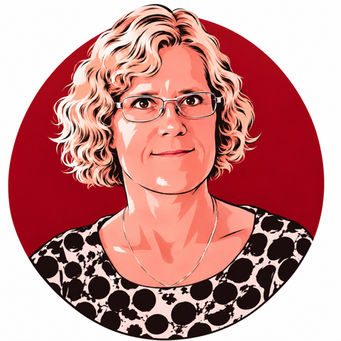
<h3>Bolette Sandford Pedersen</h3>

Professor

<button type="button" class="affiliation-filter" data-tag="University of Copenhagen" title="Click to filter">University of Copenhagen</button>

<button type="button" class="tag" data-tag="Cultural alignment" title="Click to filter">Cultural alignment</button><button type="button" class="tag" data-tag="Language" title="Click to filter">Language</button><button type="button" class="tag" data-tag="Evaluation" title="Click to filter">Evaluation</button>

<a href="news/2026/06/17/bolette-fights-for-the-danish-language-in-the-age-of-algorithms.html">Portrait →</a>

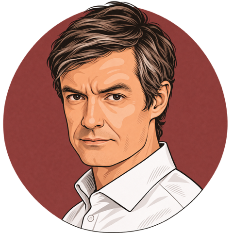
<h3>Kristoffer Laigaard Nielbo</h3>

Professor

<button type="button" class="affiliation-filter" data-tag="Aarhus University" title="Click to filter">Aarhus University</button>

<button type="button" class="tag" data-tag="Cultural analytics" title="Click to filter">Cultural analytics</button><button type="button" class="tag" data-tag="Language" title="Click to filter">Language</button>

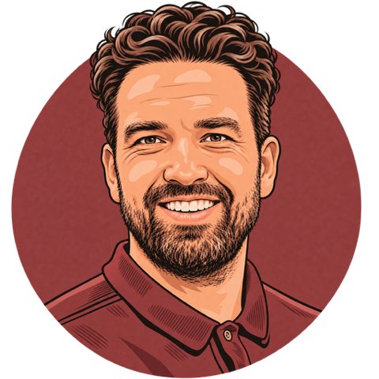
<h3>Peter Schneider-Kamp</h3>

Professor

<button type="button" class="affiliation-filter" data-tag="University of Southern Denmark" title="Click to filter">University of Southern Denmark</button>

<button type="button" class="tag" data-tag="Model training" title="Click to filter">Model training</button><button type="button" class="tag" data-tag="Automated reasoning" title="Click to filter">Automated reasoning</button>

<a href="news/2026/09/22/peter-wants-to-teach-the-machine-to-think--a-new-clever-model-has-brought-dfm-a-step-closer.html">Portrait →</a>

<h3>Torben Blach</h3>

Project Manager

<button type="button" class="affiliation-filter" data-tag="Alexandra Institute" title="Click to filter">Alexandra Institute</button>

<button type="button" class="tag" data-tag="Project management" title="Click to filter">Project management</button>

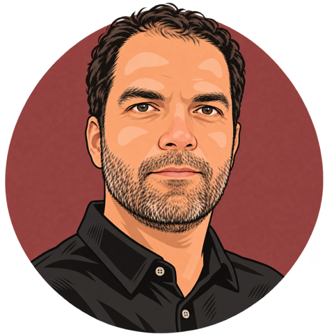
<h3>Ali Basirat</h3>

Associate Professor

<button type="button" class="affiliation-filter" data-tag="University of Copenhagen" title="Click to filter">University of Copenhagen</button>

<button type="button" class="tag" data-tag="Language" title="Click to filter">Language</button><button type="button" class="tag" data-tag="Representation learning" title="Click to filter">Representation learning</button><button type="button" class="tag" data-tag="Interpretability" title="Click to filter">Interpretability</button>

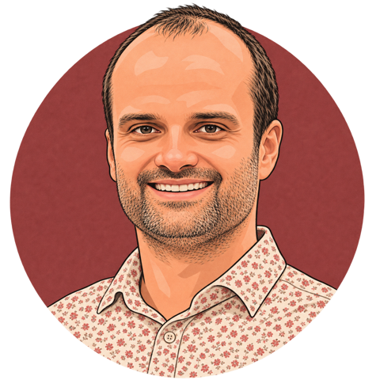
<h3>Desmond Elliott</h3>

Associate Professor

<button type="button" class="affiliation-filter" data-tag="University of Copenhagen" title="Click to filter">University of Copenhagen</button>

<button type="button" class="tag" data-tag="Multimodal models" title="Click to filter">Multimodal models</button><button type="button" class="tag" data-tag="Multilingual NLP" title="Click to filter">Multilingual NLP</button><button type="button" class="tag" data-tag="Model training" title="Click to filter">Model training</button>

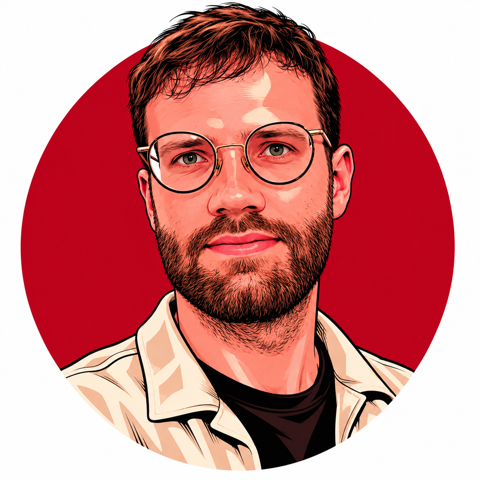
<h3>Kenneth Enevoldsen</h3>

Assistant Professor

<button type="button" class="affiliation-filter" data-tag="Aarhus University" title="Click to filter">Aarhus University</button>

<button type="button" class="tag" data-tag="Efficient development" title="Click to filter">Efficient development</button><button type="button" class="tag" data-tag="Data curation" title="Click to filter">Data curation</button><button type="button" class="tag" data-tag="Evaluation" title="Click to filter">Evaluation</button>

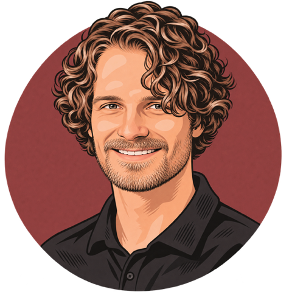
<h3>Lukas Paul Achatius Galke Poech</h3>

Associate Professor

<button type="button" class="affiliation-filter" data-tag="University of Southern Denmark" title="Click to filter">University of Southern Denmark</button>

<button type="button" class="tag" data-tag="AI safety" title="Click to filter">AI safety</button><button type="button" class="tag" data-tag="Model training" title="Click to filter">Model training</button><button type="button" class="tag" data-tag="Alignment" title="Click to filter">Alignment</button>

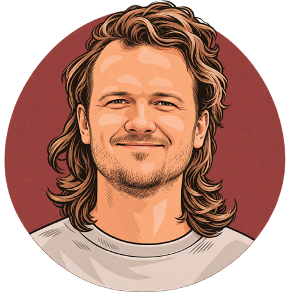
<h3>Simon Aagaard Enni</h3>

Assistant Professor

<button type="button" class="affiliation-filter" data-tag="Aarhus University" title="Click to filter">Aarhus University</button>

<button type="button" class="tag" data-tag="Participatory AI" title="Click to filter">Participatory AI</button><button type="button" class="tag" data-tag="Editorial alignment" title="Click to filter">Editorial alignment</button>

<h3>Anton Danholt Lautrup</h3>

Postdoctoral Researcher

<button type="button" class="affiliation-filter" data-tag="University of Southern Denmark" title="Click to filter">University of Southern Denmark</button>

<button type="button" class="tag" data-tag="Synthetic data" title="Click to filter">Synthetic data</button><button type="button" class="tag" data-tag="Evaluation" title="Click to filter">Evaluation</button><button type="button" class="tag" data-tag="Data curation" title="Click to filter">Data curation</button>

<h3>Barbara Scalvini</h3>

Postdoctoral Researcher

<button type="button" class="affiliation-filter" data-tag="University of Copenhagen" title="Click to filter">University of Copenhagen</button>

<button type="button" class="tag" data-tag="Cultural alignment" title="Click to filter">Cultural alignment</button><button type="button" class="tag" data-tag="Low-resource languages" title="Click to filter">Low-resource languages</button>

<h3>Federico Torrielli</h3>

Postdoctoral Researcher

<button type="button" class="affiliation-filter" data-tag="University of Southern Denmark" title="Click to filter">University of Southern Denmark</button>

<button type="button" class="tag" data-tag="AI safety" title="Click to filter">AI safety</button><button type="button" class="tag" data-tag="AI alignment" title="Click to filter">AI alignment</button><button type="button" class="tag" data-tag="Human–AI interaction" title="Click to filter">Human–AI interaction</button>

<h3>Mike Zhang</h3>

Postdoctoral Researcher

<button type="button" class="affiliation-filter" data-tag="University of Copenhagen" title="Click to filter">University of Copenhagen</button>

<button type="button" class="tag" data-tag="Language" title="Click to filter">Language</button><button type="button" class="tag" data-tag="Post-training" title="Click to filter">Post-training</button><button type="button" class="tag" data-tag="Multilingual NLP" title="Click to filter">Multilingual NLP</button>

<h3>Nicolas Marc Simon Legrand</h3>

Senior Researcher

<button type="button" class="affiliation-filter" data-tag="Aarhus University" title="Click to filter">Aarhus University</button>

<button type="button" class="tag" data-tag="Predictive coding" title="Click to filter">Predictive coding</button><button type="button" class="tag" data-tag="Security" title="Click to filter">Security</button><button type="button" class="tag" data-tag="Agentic" title="Click to filter">Agentic</button>

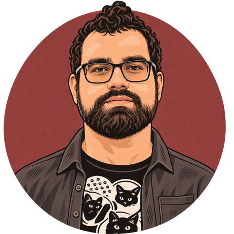
<h3>Yevhen Kostiuk</h3>

Postdoctoral Researcher

<button type="button" class="affiliation-filter" data-tag="Aarhus University" title="Click to filter">Aarhus University</button>

<button type="button" class="tag" data-tag="Cultural alignment" title="Click to filter">Cultural alignment</button><button type="button" class="tag" data-tag="Evaluation" title="Click to filter">Evaluation</button><button type="button" class="tag" data-tag="Language" title="Click to filter">Language</button>

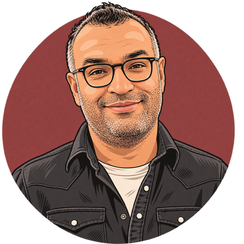
<h3>Zafar Hussain</h3>

Postdoctoral Researcher

<button type="button" class="affiliation-filter" data-tag="Aarhus University" title="Click to filter">Aarhus University</button>

<button type="button" class="tag" data-tag="Evaluation" title="Click to filter">Evaluation</button><button type="button" class="tag" data-tag="Retrieval-augmented generation" title="Click to filter">Retrieval-augmented generation</button>

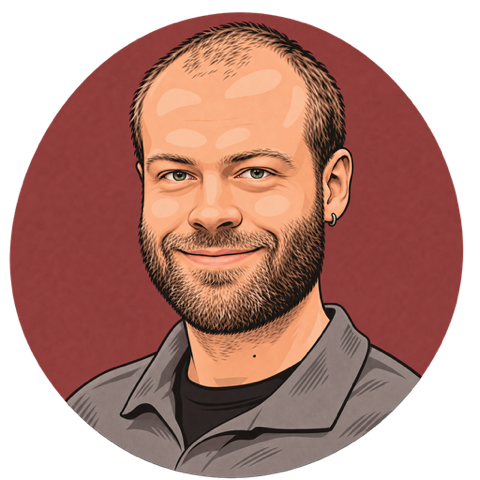
<h3>Anders Falkenhard Røn</h3>

PhD Fellow

<button type="button" class="affiliation-filter" data-tag="Aarhus University" title="Click to filter">Aarhus University</button>

<button type="button" class="tag" data-tag="Data management" title="Click to filter">Data management</button><button type="button" class="tag" data-tag="AI applications" title="Click to filter">AI applications</button>

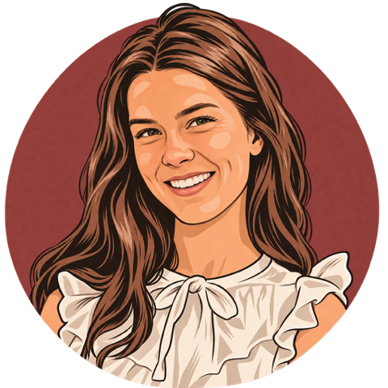
<h3>Andrea Blasi Núñez</h3>

PhD Fellow

<button type="button" class="affiliation-filter" data-tag="University of Southern Denmark" title="Click to filter">University of Southern Denmark</button>

<button type="button" class="tag" data-tag="Data curation" title="Click to filter">Data curation</button><button type="button" class="tag" data-tag="Model training" title="Click to filter">Model training</button>

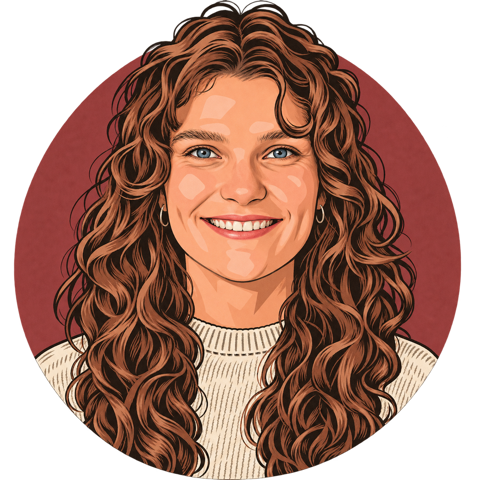
<h3>Anna Bomme Ousager</h3>

Industrial PhD Fellow

<button type="button" class="affiliation-filter" data-tag="University of Southern Denmark" title="Click to filter">University of Southern Denmark</button>

<button type="button" class="tag" data-tag="Model training" title="Click to filter">Model training</button><button type="button" class="tag" data-tag="Language" title="Click to filter">Language</button>

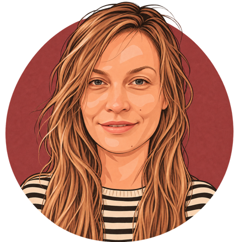
<h3>Annemette Brok Pirchert</h3>

PhD Fellow

<button type="button" class="affiliation-filter" data-tag="University of Southern Denmark" title="Click to filter">University of Southern Denmark</button>

<button type="button" class="tag" data-tag="Model training" title="Click to filter">Model training</button><button type="button" class="tag" data-tag="Mixture of experts" title="Click to filter">Mixture of experts</button><button type="button" class="tag" data-tag="Efficient models" title="Click to filter">Efficient models</button>

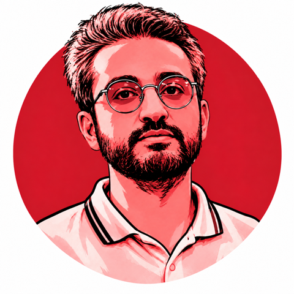
<h3>Danial Namazifard</h3>

PhD Fellow

<button type="button" class="affiliation-filter" data-tag="University of Southern Denmark" title="Click to filter">University of Southern Denmark</button>

<button type="button" class="tag" data-tag="Interpretability" title="Click to filter">Interpretability</button><button type="button" class="tag" data-tag="AI safety" title="Click to filter">AI safety</button>

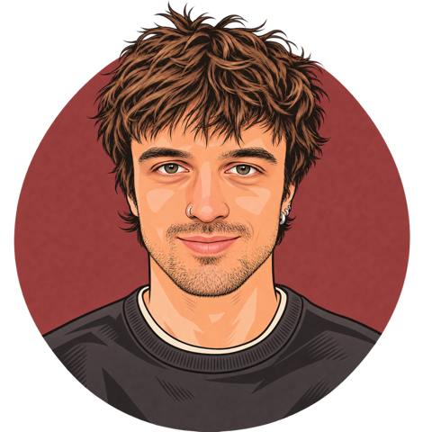
<h3>Filippo Tonini</h3>

PhD Fellow

<button type="button" class="affiliation-filter" data-tag="University of Southern Denmark" title="Click to filter">University of Southern Denmark</button>

<button type="button" class="tag" data-tag="Agentic" title="Click to filter">Agentic</button><button type="button" class="tag" data-tag="Safety" title="Click to filter">Safety</button>

<h3>Gianluca Barmina</h3>

PhD Fellow

<button type="button" class="affiliation-filter" data-tag="University of Southern Denmark" title="Click to filter">University of Southern Denmark</button>

<button type="button" class="tag" data-tag="Evaluation" title="Click to filter">Evaluation</button><button type="button" class="tag" data-tag="Post-training" title="Click to filter">Post-training</button><button type="button" class="tag" data-tag="Interpretability" title="Click to filter">Interpretability</button>

<h3>Jacob Nielsen</h3>

Industrial PhD Fellow

<button type="button" class="affiliation-filter" data-tag="University of Southern Denmark" title="Click to filter">University of Southern Denmark</button>

<button type="button" class="tag" data-tag="Model training" title="Click to filter">Model training</button><button type="button" class="tag" data-tag="Quantization" title="Click to filter">Quantization</button><button type="button" class="tag" data-tag="Efficient inference" title="Click to filter">Efficient inference</button>

<h3>Mogens Henrik From</h3>

PhD Fellow

<button type="button" class="affiliation-filter" data-tag="University of Southern Denmark" title="Click to filter">University of Southern Denmark</button>

<button type="button" class="tag" data-tag="Distributed training" title="Click to filter">Distributed training</button><button type="button" class="tag" data-tag="Efficient models" title="Click to filter">Efficient models</button><button type="button" class="tag" data-tag="Long-context inference" title="Click to filter">Long-context inference</button>

<h3>Márton Kardos</h3>

PhD Fellow

<button type="button" class="affiliation-filter" data-tag="Aarhus University" title="Click to filter">Aarhus University</button>

<button type="button" class="tag" data-tag="Evaluation" title="Click to filter">Evaluation</button><button type="button" class="tag" data-tag="Representation learning" title="Click to filter">Representation learning</button><button type="button" class="tag" data-tag="Topic modelling" title="Click to filter">Topic modelling</button>

<h3>Nathalie Norman</h3>

PhD Fellow

<button type="button" class="affiliation-filter" data-tag="University of Copenhagen" title="Click to filter">University of Copenhagen</button>

<button type="button" class="tag" data-tag="Evaluation" title="Click to filter">Evaluation</button><button type="button" class="tag" data-tag="Cultural alignment" title="Click to filter">Cultural alignment</button><button type="button" class="tag" data-tag="Language" title="Click to filter">Language</button>

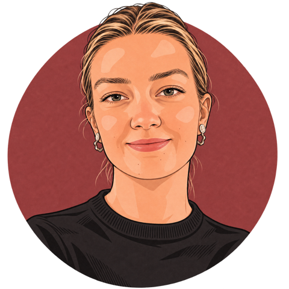
<h3>Stine Lyngsø Beltoft</h3>

PhD Fellow

<button type="button" class="affiliation-filter" data-tag="University of Southern Denmark" title="Click to filter">University of Southern Denmark</button>

<button type="button" class="tag" data-tag="Qualitative AI" title="Click to filter">Qualitative AI</button><button type="button" class="tag" data-tag="Alignment" title="Click to filter">Alignment</button><button type="button" class="tag" data-tag="Human–AI interaction" title="Click to filter">Human–AI interaction</button>

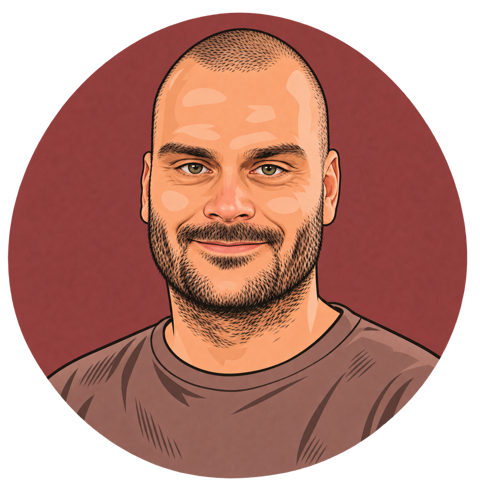
<h3>Andreas Nugaard Holm</h3>

AI Specialist

<button type="button" class="affiliation-filter" data-tag="Alexandra Institute" title="Click to filter">Alexandra Institute</button>

<button type="button" class="tag" data-tag="AI applications" title="Click to filter">AI applications</button><button type="button" class="tag" data-tag="Language" title="Click to filter">Language</button>

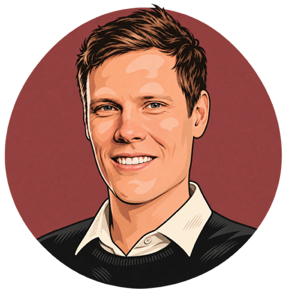
<h3>Per Andersen</h3>

Senior AI Specialist

<button type="button" class="affiliation-filter" data-tag="Alexandra Institute" title="Click to filter">Alexandra Institute</button>

<button type="button" class="tag" data-tag="AI applications" title="Click to filter">AI applications</button><button type="button" class="tag" data-tag="Model training" title="Click to filter">Model training</button>

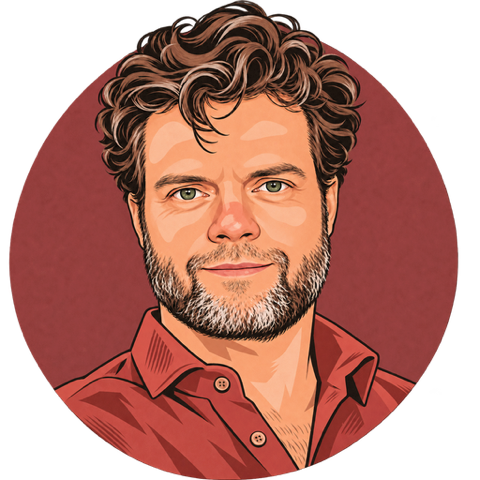
<h3>Per Møldrup-Dalum</h3>

Chief Consultant, Data Management

<button type="button" class="affiliation-filter" data-tag="Aarhus University" title="Click to filter">Aarhus University</button>

<button type="button" class="tag" data-tag="Data management" title="Click to filter">Data management</button><button type="button" class="tag" data-tag="Research infrastructure" title="Click to filter">Research infrastructure</button>

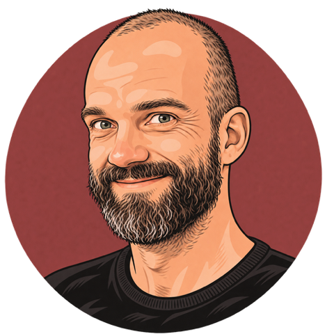
<h3>Peter Bjerregaard Vahlstrup</h3>

Special Consultant, Web Development

<button type="button" class="affiliation-filter" data-tag="Aarhus University" title="Click to filter">Aarhus University</button>

<button type="button" class="tag" data-tag="Research software" title="Click to filter">Research software</button><button type="button" class="tag" data-tag="Data curation" title="Click to filter">Data curation</button>

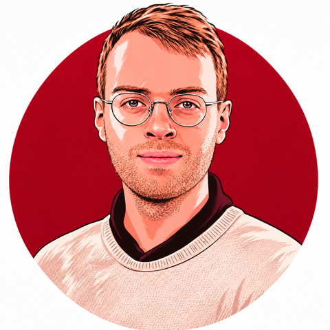
<h3>Rasmus Larsen</h3>

Senior AI Specialist

<button type="button" class="affiliation-filter" data-tag="Alexandra Institute" title="Click to filter">Alexandra Institute</button>

<button type="button" class="tag" data-tag="Model training" title="Click to filter">Model training</button><button type="button" class="tag" data-tag="AI infrastructure" title="Click to filter">AI infrastructure</button>

<h3>Aleksandrs Baskakovs</h3>

Research Assistant

<button type="button" class="affiliation-filter" data-tag="Aarhus University" title="Click to filter">Aarhus University</button>

<button type="button" class="tag" data-tag="Predictive coding" title="Click to filter">Predictive coding</button><button type="button" class="tag" data-tag="Architecture development" title="Click to filter">Architecture development</button>

<h3>Anna Davidsen Buhl</h3>

Research Assistant

<button type="button" class="affiliation-filter" data-tag="University of Copenhagen" title="Click to filter">University of Copenhagen</button>

<button type="button" class="tag" data-tag="Cultural alignment" title="Click to filter">Cultural alignment</button>

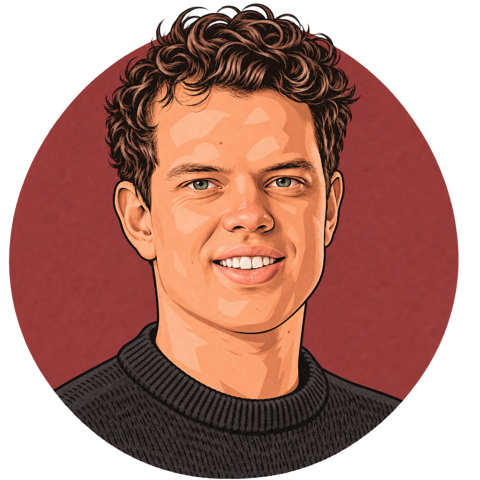
<h3>Gustav Idun Sloth</h3>

Student Data Scientist

<button type="button" class="affiliation-filter" data-tag="Aarhus University" title="Click to filter">Aarhus University</button>

<button type="button" class="tag" data-tag="Data curation" title="Click to filter">Data curation</button>

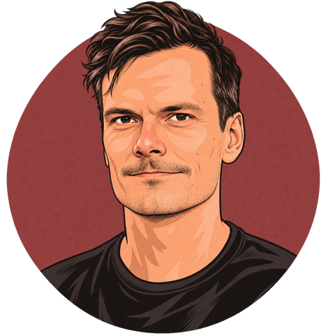
<h3>Henrik Hoffmann</h3>

Guest Researcher

<button type="button" class="affiliation-filter" data-tag="University of Southern Denmark" title="Click to filter">University of Southern Denmark</button>

<button type="button" class="tag" data-tag="Model development" title="Click to filter">Model development</button><button type="button" class="tag" data-tag="AI applications" title="Click to filter">AI applications</button>

<h3>Johana Mayerova</h3>

Student Developer

<button type="button" class="affiliation-filter" data-tag="Aarhus University" title="Click to filter">Aarhus University</button>

<button type="button" class="tag" data-tag="Software development" title="Click to filter">Software development</button><button type="button" class="tag" data-tag="Research software" title="Click to filter">Research software</button>

<h3>Mikkel Krøjer Svendsen</h3>

Student Developer

<button type="button" class="affiliation-filter" data-tag="Aarhus University" title="Click to filter">Aarhus University</button>

<button type="button" class="tag" data-tag="Software development" title="Click to filter">Software development</button><button type="button" class="tag" data-tag="Research software" title="Click to filter">Research software</button>

<h3>Muhammad Rajabinasab</h3>

Research Assistant

<button type="button" class="affiliation-filter" data-tag="University of Southern Denmark" title="Click to filter">University of Southern Denmark</button>

<button type="button" class="tag" data-tag="Explainable AI" title="Click to filter">Explainable AI</button><button type="button" class="tag" data-tag="Evaluation" title="Click to filter">Evaluation</button>

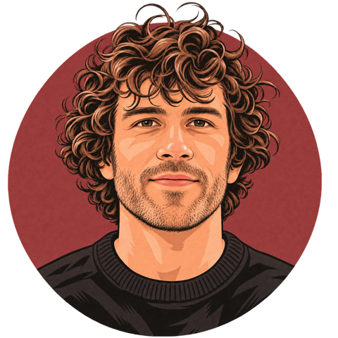
<h3>Sylvain Pierre Estebe</h3>

Research Assistant

<button type="button" class="affiliation-filter" data-tag="Aarhus University" title="Click to filter">Aarhus University</button>

<button type="button" class="tag" data-tag="Cultural evolution" title="Click to filter">Cultural evolution</button><button type="button" class="tag" data-tag="Cognitive modelling" title="Click to filter">Cognitive modelling</button>

<h3>Vladimir Salnikov</h3>

Student Developer

<button type="button" class="affiliation-filter" data-tag="Aarhus University" title="Click to filter">Aarhus University</button>

<button type="button" class="tag" data-tag="Data curation" title="Click to filter">Data curation</button><button type="button" class="tag" data-tag="Evaluation" title="Click to filter">Evaluation</button>

<h3>Anders Holmgaard</h3>

Communications Advisor

<button type="button" class="affiliation-filter" data-tag="Holmgaard Media" title="Click to filter">Holmgaard Media</button>

<button type="button" class="tag" data-tag="Communication" title="Click to filter">Communication</button>

<h2 class="people-alumni">Alumni</h2>

<h3>Jonas Vistrup</h3>

PhD Fellow

<button type="button" class="affiliation-filter" data-tag="University of Southern Denmark" title="Click to filter">University of Southern Denmark</button>

<button type="button" class="tag" data-tag="Explainable AI" title="Click to filter">Explainable AI</button><button type="button" class="tag" data-tag="Legal AI" title="Click to filter">Legal AI</button><button type="button" class="tag" data-tag="Logic programming" title="Click to filter">Logic programming</button>

<h3>Balázs Szabó</h3>

Student Data Scientist

<button type="button" class="affiliation-filter" data-tag="Aarhus University" title="Click to filter">Aarhus University</button>

<button type="button" class="tag" data-tag="Data curation" title="Click to filter">Data curation</button>

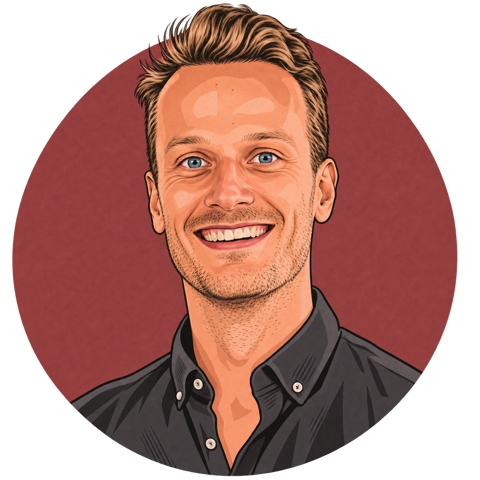
<h3>Dan Saattrup Smart</h3>

Senior AI Specialist

<button type="button" class="affiliation-filter" data-tag="Alexandra Institute" title="Click to filter">Alexandra Institute</button>

<button type="button" class="tag" data-tag="Evaluation" title="Click to filter">Evaluation</button><button type="button" class="tag" data-tag="AI applications" title="Click to filter">AI applications</button>

<h3>Kristian Nørgaard Jensen</h3>

AI Specialist

<button type="button" class="affiliation-filter" data-tag="Alexandra Institute" title="Click to filter">Alexandra Institute</button>

<button type="button" class="tag" data-tag="Data curation" title="Click to filter">Data curation</button><button type="button" class="tag" data-tag="AI applications" title="Click to filter">AI applications</button>

